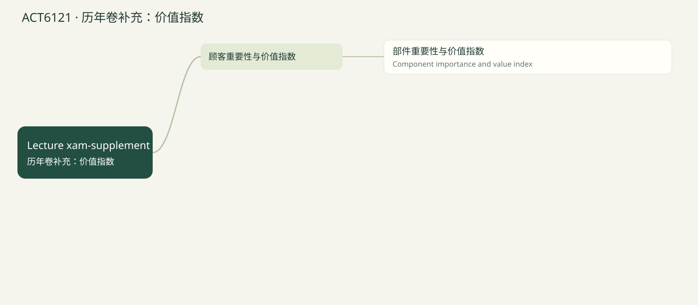

# ACT6121 · 历年卷补充：价值指数 / 2024 supplement: value engineering

覆盖当前已上传 Lecture 1–5 的知识点；case study 文件夹未读取。Lecture 1课程大纲提到 life-cycle costs，但尚无该章课件，因此未假定已经讲完或排除出最终考试。后续上传后可新增章节。页码均指PDF文件页序，不是幻灯片页脚编号。 2024历年卷训练已融合：原卷14题及14道变式；价值指数单列补充，不冒充已上传Lecture。

## 知识点清单

- [ ] 部件重要性与价值指数 / Component importance and value index

## 部件重要性与价值指数 / Component importance and value index

来源：Lecture xam-supplement PDF 2024卷 pp.11–12（非Lecture 6）

顾客标准的重要性先归一化为权重；用各部件对标准的贡献比例做加权求和，得到部件的重要性。

成本占比=部件成本/全部部件成本；价值指数=重要性占比/成本占比。大于1表明相对顾客价值获得的资源较少，可考虑增强；小于1应检查降本机会，同时维持服务质量。

这是2024年试题考点，不表示当前未上传的lecture已经讲授；后续课件到位后再按老师口径对齐。

Normalize customer importance, weight component contributions, then compare importance share with cost share.

**Formula:** Importance_j = Σ(weight_i × contribution_ij); VI = Importance share / Cost share

**易错点：** 重要性分数必须先归一化；成本占比和重要性必须用相同单位。

### 讲解例题 / Worked example

Importance40.5%,cost share20%. Value index?

重要性40.5%、成本占20%，求价值指数。

Unit / 单位：times

**解析 / Solution**

.405/.20=2.025 →2.03.

.405/.20=2.025，显示2.03。

## 章节练习 / Chapter exercises

以下先列出全部题目，后附所有答案。

### 1. 2024 C6 · Rick’s · value engineering

2024 C6 · Rick’s · value engineering

2024 原题 · 7分 · 用户提供的期中答案卷；英文题面保留实质内容，表格转写 / Past-paper question

Customers value taste/comfort/enjoyment with importance scores3/2/5. Components menu&preparation/waitstaff/ingredients cost$5/$12/$8. Contributions to each criterion: taste25%/35%/40%;comfort15%/75%/10%;enjoyment60%/20%/20%. Round intermediate and final results to two decimals. Find (1)component importance(3points),(2)value indices(3),(3)recommended actions(1).

顾客标准味道/舒适/享受，重要性分数3/2/5。菜单准备/服务员/原料成本5/12/8。对各标准贡献：味道25%/35%/40%；舒适15%/75%/10%；享受60%/20%/20%。中间和结果两位。求部件重要性（3分）、价值指数（3）、改进动作（1）。

### 2. Variation · C6

变式训练 · C6

2024 C6 原创变式 · 训练参考分值7分 / Original variation

Weights taste/comfort/enjoyment4/3/3; component contributions by criterion remain25/35/40%,15/75/10%,60/20/20%. Costs menu/staff/ingredients6/10/9. Find importance,cost shares,VI and priorities.

重要性分数改4/3/3，三个标准下部件贡献仍为25/35/40%、15/75/10%、60/20/20%。成本改6/10/9，求重要性、成本比、VI及优先级。

---

## 全部答案与解析 / Collected solutions

### 1. 2024 C6 · Rick’s · value engineering

2024 C6 · Rick’s · value engineering

Criterion weights30%/20%/50%. Component importance: menu .3×.25+.2×.15+.5×.60=40.50%;staff35.50%;ingredients24.00%. Costs total25;cost shares20%/48%/32%. VI2.03/.74/.75. The key recommends investing/improving menu and reducing other costs. Interpret as value-engineering priorities, not a guarantee that cutting staff/ingredients will preserve taste and comfort.

标准权重30%/20%/50%。菜单重要性7.5%+3%+30%=40.50%；服务员35.50%；原料24.00%。总成本25，成本比20%/48%/32%。VI2.03/.74/.75。原答案建议加强菜单准备、降低其他成本；实际动作需保护味道舒适等质量，不能机械裁减。

### 2. Variation · C6

变式训练 · C6

Importance32.50%/42.50%/25.00%;cost shares24%/40%/36%;VI1.35/1.06/.69. Investigate ingredients cost/value first; preserve essential quality. Menu and staff have VI>1.

重要性32.50%/42.50%/25.00%；成本24%/40%/36%；VI1.35/1.06/.69。优先检查原料成本价值匹配；菜单和服务员VI>1。

## 课件核对说明

2024历年卷训练

章节练习顶部优先排列2024原题与对应变式。题目与答案均可切换中英。综合题由你依据步骤自评；不会时可把关联知识点加入回炉。原题保留年份与分值；变式明确为原创。

## 思维导图

