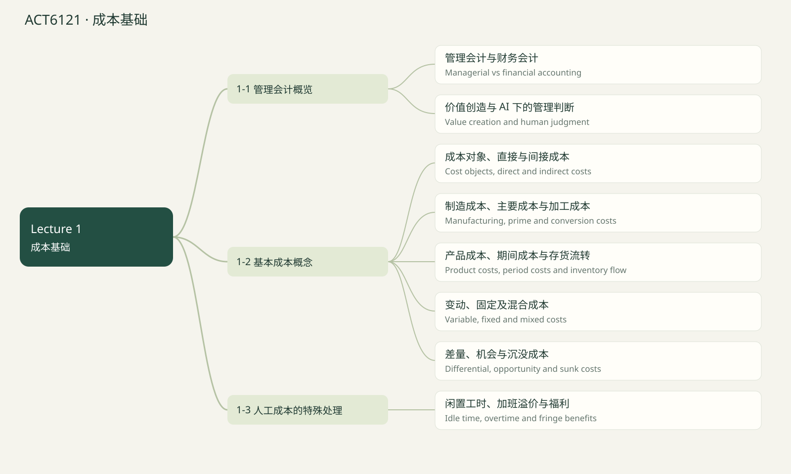

# ACT6121 · 成本基础 / Cost foundations

覆盖当前已上传 Lecture 1–5 的知识点；case study 文件夹未读取。Lecture 1课程大纲提到 life-cycle costs，但尚无该章课件，因此未假定已经讲完或排除出最终考试。后续上传后可新增章节。页码均指PDF文件页序，不是幻灯片页脚编号。 2024历年卷训练已融合：原卷14题及14道变式；价值指数单列补充，不冒充已上传Lecture。

## 知识点清单

- [ ] 管理会计与财务会计 / Managerial vs financial accounting

- [ ] 价值创造与 AI 下的管理判断 / Value creation and human judgment

- [ ] 成本对象、直接与间接成本 / Cost objects, direct and indirect costs

- [ ] 制造成本、主要成本与加工成本 / Manufacturing, prime and conversion costs

- [ ] 产品成本、期间成本与存货流转 / Product costs, period costs and inventory flow

- [ ] 变动、固定及混合成本 / Variable, fixed and mixed costs

- [ ] 差量、机会与沉没成本 / Differential, opportunity and sunk costs

- [ ] 闲置工时、加班溢价与福利 / Idle time, overtime and fringe benefits

## 管理会计与财务会计 / Managerial vs financial accounting

来源：Lecture 1 PDF 8–10, 18–24

管理会计服务内部经理，提供财务与非财务信息，强调相关性、及时性和面向未来的决策；可以细分到产品、客户或部门。财务会计主要服务外部使用者，强调历史、可验证性、精确性和整体报告。

规划 Planning 设定目标与预算；控制 Controlling 比较实际与计划并纠偏；决策 Decision making 在方案间选择。三者相互关联，不是只有决策才需要会计信息。

历史脉络：早期产品成本计量，铁路与钢铁成本控制，随后扩展到规划和绩效管理。内部报告形式按管理需求设计。

Managerial accounting supports planning, control and decisions with relevant, timely financial and nonfinancial information.

**Formula:** Plan → Act → Compare → Adjust

**易错点：** 编预算是规划；分析实际偏差是控制。

### 讲解例题 / Worked example

A manager compares actual costs with budget. Which function?

经理将实际成本与预算比较，属于哪项职能？

1. Control

控制
2. Planning only

仅规划
3. External reporting

外部报告

**解析 / Solution**

Comparison provides feedback for control.

实际与预算的比较提供控制反馈。

## 价值创造与 AI 下的管理判断 / Value creation and human judgment

来源：Lecture 1 PDF 11–17, 25

管理会计不仅记录数字，也识别增值与非增值活动，帮助效率、战略、跨职能协作及转型。非增值活动如返工可能暂时必要，但应分析其成因。

AI 可自动化发票、对账、风险识别和预测；财务人员要解释输出并结合业务。信息集中或分散，应取决于谁需要什么信息来做什么决策。

成本模型的假设、成本对象、因果关系和最终决策仍由人判断。课件里的公司新闻属于课堂情境，本复习不将其当作经独立验证的时事结论。

AI can improve measurement and prediction; managers remain responsible for assumptions, relevance and decisions.

**Formula:** Data + assumptions → Model → Interpretation → Decision

**易错点：** 相关性不等于因果关系；数据更快不保证模型正确。

### 讲解例题 / Worked example

AI predicts a lower defect rate. Who chooses whether to invest?

AI 预测缺陷率下降，由谁决定是否投资？

1. Management using evidence

管理者依据证据判断
2. The model automatically

模型自动决定
3. The invoice system

发票系统

**解析 / Solution**

Prediction informs judgment but does not replace it.

预测支持判断，不能代替判断。

## 成本对象、直接与间接成本 / Cost objects, direct and indirect costs

来源：Lecture 1 PDF 29–31

成本对象是希望计量成本的任何事物，如产品、服务、部门、客户。直接成本能方便、经济地追溯到该对象；间接成本需要分配。共同成本同时支持多个对象。

同一成本的分类会随对象改变：工厂经理薪酬对整个工厂可直接追溯，但对单件产品通常间接。分类前必须写清“相对于谁”。

直接/间接与固定/变动是不同维度；固定薪酬也可以是某部门的直接成本。

Directness is relative to the cost object, not to cost behavior.

**Formula:** Cost object first → Trace if feasible → Allocate otherwise

**易错点：** 不要把 direct 当作 variable 的同义词。

### 讲解例题 / Worked example

A factory manager’s salary is indirect to individual products but direct to the factory. Correct?

厂长工资对单件产品间接，对工厂直接，正确吗？

1. Yes

是
2. No

否

**解析 / Solution**

Changing the cost object changes traceability.

成本对象改变，可追溯性随之改变。

## 制造成本、主要成本与加工成本 / Manufacturing, prime and conversion costs

来源：Lecture 1 PDF 32–40

制造成本分为直接材料 DM、直接人工 DL、制造费用 MOH。润滑油等难以经济追溯的材料、维修工工资、厂房租金属于 MOH。销售和行政属于非制造成本。

主要成本 Prime cost = DM + DL；加工成本 Conversion cost = DL + MOH。两者都含 DL，不能直接相加当总制造成本。

分类看用途：工厂设备折旧是 MOH；行政办公设备折旧是行政费用；发货运费通常是销售费用。

Manufacturing cost is DM + DL + MOH. Prime and conversion costs overlap in direct labor.

**Formula:** Prime = DM + DL; Conversion = DL + MOH

**易错点：** 工厂经理对工厂可直接追溯，但对产品通常是间接人工，归入 MOH。

### 讲解例题 / Worked example

DM $90, DL $60, MOH $40. Find conversion cost.

DM 90、DL 60、MOH 40，计算加工成本。

Unit / 单位：$

**解析 / Solution**

Conversion = 60 + 40 = 100.

加工成本 = 60 + 40 = 100。

## 产品成本、期间成本与存货流转 / Product costs, period costs and inventory flow

来源：Lecture 1 PDF 41–54

本节按吸收成本法：制造成本先进入存货，售出时才成为 COGS；销售和行政费用当期计入损益。Product cost 并不是发生时就全部费用化。

制造企业有原材料 RM、在产品 WIP、产成品 FG。RM 领用进入生产，DM、DL、MOH 进入 WIP，完工转入 FG，售出转为 COGS。商业企业主要有商品存货。

任何存货账户均满足期初 + 增加 − 减少 = 期末。计算 DM used 时若包含间接材料，要先减去间接材料；不要把购买金额直接当本期耗用。

Inventoriable costs flow through RM, WIP and FG before becoming COGS when sold.

**Formula:** COGM = Beginning WIP + manufacturing costs added − Ending WIP; COGS = Beginning FG + COGM − Ending FG

**易错点：** 现金付款时点不决定产品成本何时计入损益。

### 讲解例题 / Worked example

Beginning FG $20, COGM $150, ending FG $30. Find unadjusted COGS.

期初 FG 20、COGM 150、期末 FG 30，求未调整 COGS。

Unit / 单位：$

**解析 / Solution**

20 + 150 − 30 = 140.

20 + 150 − 30 = 140。

## 变动、固定及混合成本 / Variable, fixed and mixed costs

来源：Lecture 1 PDF 55–63

在相关范围内，变动成本总额随业务量同比变化，单位变动成本不变；固定成本总额不变，单位固定成本随业务量增加而下降。

混合成本含固定项 a 和每单位变动项 b：Y = a + bX。先找真正驱动成本的业务量，例如机器小时，而不是自动用销量。

约束性固定成本 committed 如长期厂房投资，短期难改；酌量性固定成本 discretionary 如年度广告预算，可由管理者短期调整。跨越容量区间后固定成本可能阶梯式增加。

Within the relevant range, variable cost per unit and total fixed cost remain constant.

**Formula:** Y = a + bX; Fixed cost per unit = a / X

**易错点：** 不要假定固定成本在所有产量下永远不变，也不要把单位固定成本当增量成本。

### 讲解例题 / Worked example

Monthly utility cost is $40 + $0.03 per kWh. At 2,000 kWh, find total cost.

月电费 = 40 + 每度 0.03，使用 2,000 度，求总费用。

Unit / 单位：$

**解析 / Solution**

40 + .03 × 2,000 = 100.

40 + .03 × 2,000 = 100。

## 差量、机会与沉没成本 / Differential, opportunity and sunk costs

来源：Lecture 1 PDF 67–72

相关成本是未来且在方案间不同的成本；差量成本表示方案成本之差。不能仅凭 variable 或 fixed 判断相关性。

机会成本是选择一个方案放弃的最佳替代收益，往往不记账但应纳入决策。产能满负荷时特殊订单可能挤出正常销售，失去的贡献毛益就是机会成本。

沉没成本已发生且无法改变，对当前选择不相关。购票支出不可退款时，应比较未来体验与未来可变支出，而非“不能浪费已花的钱”。

Relevant costs differ between future alternatives. Sunk costs are irrelevant; opportunity costs can be relevant without a ledger entry.

**Formula:** Incremental benefit − incremental outlay − opportunity cost

**易错点：** 满产时的机会成本通常是放弃的贡献毛益，不是机械地把全部正常收入当净损失。

### 讲解例题 / Worked example

An order earns $500 and adds $300 cost but displaces $150 contribution. Find net benefit.

订单收入 500、增量成本 300、挤出贡献毛益 150，求净收益。

Unit / 单位：$

**解析 / Solution**

500 − 300 − 150 = 50.

500 − 300 − 150 = 50。

## 闲置工时、加班溢价与福利 / Idle time, overtime and fringe benefits

来源：Lecture 1 PDF 73–76

正常生产中因停电、缺料、机器故障产生的闲置人工通常计入 MOH。生产工人的正常工资可计入 DL，但加班溢价通常计入 MOH。

例如正常工资 20/小时，加班支付 30/小时：额外的 10 是 premium，不是整笔 30 都是溢价。题目若说明特定订单导致加班或长期稳定加班，须按给定政策处理。

福利 Fringe benefits 如保险、退休金，企业可能全部列入 MOH，也可能把直接工人的福利列入 DL；答题需注明采用的政策。

Idle time and overtime premiums are ordinarily overhead; fringe-benefit classification depends on policy.

**Formula:** Overtime premium = Overtime hours × (Overtime rate − Normal rate)

**易错点：** 不要将加班全部工资和加班溢价混为一谈。

### 讲解例题 / Worked example

Normal rate $20; overtime rate $30; overtime 6 hours. Find premium.

正常时薪 20，加班时薪 30，加班 6 小时，求溢价。

Unit / 单位：$

**解析 / Solution**

6 × (30 − 20) = 60.

6 × (30 − 20) = 60。

## 章节练习 / Chapter exercises

以下先列出全部题目，后附所有答案。

### 1. 2024 B2 · Recover fixed totals

2024 B2 · Recover fixed totals

2024 原题 · 2分 · 用户提供的期中答案卷；英文题面保留实质内容，表格转写 / Past-paper question

Ouelette’s relevant range is3,000–7,000 units. At5,000 units average costs/unit: DM5.25,DL4.05,VMOH1.30,FMOH3.00,fixed selling.70,fixed admin.40,commissions.50,variable admin.45. At6,000 produced, what is total indirect manufacturing cost?

相关范围3,000—7,000件，5,000件时单位DM5.25、DL4.05、VMOH1.30、FMOH3、固定销售.70、固定行政.40、佣金.50、变动行政.45。产6,000件，间接制造成本总额？

### 2. Variation · B2

变式训练 · B2

2024 B2 原创变式 · 训练参考分值2分 / Original variation

At4,000 units, VMOH$2/unit and FMOH$5/unit. At6,000 units within relevant range, find total MOH and FMOH/unit.

4,000件时VMOH2/件、FMOH5/件。相关范围内产6,000件，求MOH总额与单位FMOH。

### 3. Dorlane: classify costs and explain “at cost”

Dorlane：成本分类与“按成本出售”

Tutorial 1 Q1，PDF pp.1–2；答案 pp.1–2；Excel Q1（重述 / Restated）

Dorlane produces 2,000 patio sets at full capacity. Annual costs ($): direct factory labor 118,000; advertising 50,000; factory supervision 40,000; factory property tax 3,500; sales commissions 80,000; factory insurance 2,500; office depreciation 4,000; factory equipment lease 12,000; indirect factory materials 6,000; factory building depreciation 10,000; administrative supplies 3,000; administrative salaries 60,000; direct materials 94,000; factory utilities 20,000.
1. Classify each by behavior and by S&A / direct product / indirect product cost. Follow the tutorial assumption that utilities and administrative supplies are variable.
2. Find total product cost and cost per set.
3. Explain the effect of producing only 1,000 sets within the relevant range.
4. Explain why a relative and the president may disagree on “at cost”; discuss opportunity cost at full capacity.

Dorlane满负荷年产2,000套家具。全年成本（美元）：直接工厂人工118,000；广告50,000；工厂监督40,000；厂房房产税3,500；销售佣金80,000；工厂保险2,500；办公折旧4,000；工厂设备租赁12,000；间接材料6,000；厂房折旧10,000；行政用品3,000；行政工资60,000；直接材料94,000；工厂水电20,000。
1. 分别按变动/固定，以及销售行政/直接产品/间接产品成本分类。按tutorial假定水电和行政用品为变动。
2. 求产品总成本和每套成本。
3. 相关范围内产量降至1,000套，每套成本如何变化？
4. 解释亲属和总裁对“按成本出售”的分歧，并讨论满产下机会成本。

### 4. Managerial vs financial accounting

管理会计与财务会计

原创基础题 / Original drill · 与模卡复测共享题目

Preparing next year’s sales budget is:
1. Control
2. Planning
3. Audit

编制明年销售预算属于：
1. 控制
2. 规划
3. 审计

### 5. Value creation and human judgment

价值创造与 AI 下的管理判断

原创基础题 / Original drill · 与模卡复测共享题目

Decentralized information should be designed around:
1. Decision needs
2. The largest possible report
3. Past spending only

分散化信息系统应围绕：
1. 决策需要
2. 尽可能大的报告
3. 仅历史支出

### 6. Cost objects, direct and indirect costs

成本对象、直接与间接成本

原创基础题 / Original drill · 与模卡复测共享题目

A dedicated product designer’s fixed salary can be direct to a product line.
1. True
2. False

专门产品设计师的固定薪酬可以是产品线直接成本。
1. 正确
2. 错误

### 7. Manufacturing, prime and conversion costs

制造成本、主要成本与加工成本

原创基础题 / Original drill · 与模卡复测共享题目

Prime cost is $240 and DL is $90. MOH is $70. Find total manufacturing cost.

主要成本 240、DL 90、MOH 70，计算总制造成本。

### 8. Product costs, period costs and inventory flow

产品成本、期间成本与存货流转

原创基础题 / Original drill · 与模卡复测共享题目

Beginning RM $50, purchases $400, ending RM $70, indirect materials used $30. Find DM used.

期初 RM 50、采购 400、期末 RM 70、间接材料耗用 30，求 DM 耗用。

### 9. Variable, fixed and mixed costs

变动、固定及混合成本

原创基础题 / Original drill · 与模卡复测共享题目

Fixed rent $12,000 covers up to 2,000 units. At 1,500 units, find fixed cost per unit.

固定租金 12,000 可支持最多 2,000 件，产量 1,500 时求单位固定成本。

### 10. Differential, opportunity and sunk costs

差量、机会与沉没成本

原创基础题 / Original drill · 与模卡复测共享题目

Past development $5,000 is unrecoverable. Further work costs $1,000 and yields $1,800. Find incremental benefit.

历史研发 5,000 不可收回，继续投入 1,000 可获 1,800，求增量收益。

### 11. Idle time, overtime and fringe benefits

闲置工时、加班溢价与福利

原创基础题 / Original drill · 与模卡复测共享题目

A worker is idle for 4 hours at $25/hour due to a power failure. Find ordinary MOH charge.

工人停电闲置 4 小时，时薪 25，通常计入 MOH 多少？

---

## 全部答案与解析 / Collected solutions

### 1. 2024 B2 · Recover fixed totals

2024 B2 · Recover fixed totals

22,800=1.30×6,000+3×5,000. Fixed MOH total is15,000; exclude DM,DL and all S&A.

22,800=7,800+15,000。FMOH总额由旧产量5,000反推；排除DM、DL和全部S&A。

### 2. Variation · B2

变式训练 · B2

FMOH20,000; total32,000; FMOH/unit3.3333.

固定总额20,000；MOH32,000；单位固定3.3333。

### 3. Dorlane: classify costs and explain “at cost”

Dorlane：成本分类与“按成本出售”

1. Variable/direct product: labor 118,000, DM 94,000. Variable/indirect product: indirect materials 6,000, utilities 20,000. Variable/S&A: commissions 80,000, supplies 3,000. Fixed/indirect product: supervision 40,000, tax 3,500, insurance 2,500, lease 12,000, factory depreciation 10,000. Fixed/S&A: advertising 50,000, office depreciation 4,000, office salaries 60,000.
Totals: variable 321,000; fixed 182,000; S&A 197,000; direct product 212,000; indirect product 94,000. Both classification dimensions total 503,000.
2. Product cost = 306,000; per set = 153.
3. Average cost rises because fixed manufacturing cost is spread over fewer units. Assuming proportional variable costs, variable manufacturing cost = 119/set, fixed manufacturing cost = 68,000, giving 187/set at 1,000 sets.
4. The president may mean full manufacturing cost $153; the relative may mean DM only $47 or DM+DL $106. At full capacity, supplying the relative sacrifices normal-sale contribution. Relevant production cost plus lost contribution can justify the normal price. The opportunity cost itself is the foregone contribution, not automatically gross revenue.

1. 变动/直接产品：人工118,000、DM94,000；变动/间接产品：间接材料6,000、水电20,000；变动/销售行政：佣金80,000、用品3,000。固定/间接产品：监督40,000、税3,500、保险2,500、租赁12,000、厂房折旧10,000；固定/销售行政：广告50,000、办公折旧4,000、行政工资60,000。
汇总：变动321,000；固定182,000；销售行政197,000；直接产品212,000；间接产品94,000。两个分类维度均合计503,000。
2. 产品总成本306,000；每套153。
3. 固定制造成本分摊到更少件数，单位成本上升。若变动成本同比变化：变动制造119/套、固定制造68,000，产1,000套时为187/套。
4. 总裁可能指完整制造成本153；亲属可能只指材料47或DM+DL106。满产时给亲属供货会挤出正常销售，损失正常贡献毛益；相关生产成本加机会成本可支持正常售价。机会成本本身是放弃贡献，不宜机械等同全部销售收入。

### 4. Managerial vs financial accounting

管理会计与财务会计

Planning
A budget specifies how future goals will be achieved.

规划
预算说明未来目标如何实现。

### 5. Value creation and human judgment

价值创造与 AI 下的管理判断

Decision needs
Relevant information must reach the responsible decision maker.

决策需要
相关信息应到达负责决策的人。

### 6. Cost objects, direct and indirect costs

成本对象、直接与间接成本

True
Direct and fixed describe separate dimensions.

正确
直接和固定属于不同分类维度。

### 7. Manufacturing, prime and conversion costs

制造成本、主要成本与加工成本

310 $
DM = 240 − 90 = 150; total = 150 + 90 + 70 = 310.

310 $
DM = 240 − 90 = 150；总额 = 150 + 90 + 70 = 310。

### 8. Product costs, period costs and inventory flow

产品成本、期间成本与存货流转

350 $
All materials used = 50 + 400 − 70 = 380; DM = 380 − 30 = 350.

350 $
总材料耗用 = 380；减去间接材料 30，DM = 350。

### 9. Variable, fixed and mixed costs

变动、固定及混合成本

8 $/unit
12,000 / 1,500 = 8.

8 $/unit
12,000 / 1,500 = 8。

### 10. Differential, opportunity and sunk costs

差量、机会与沉没成本

800 $
1,800 − 1,000 = 800. Ignore the $5,000 sunk cost.

800 $
1,800 − 1,000 = 800，忽略沉没成本 5,000。

### 11. Idle time, overtime and fringe benefits

闲置工时、加班溢价与福利

100 $
4 × 25 = 100.

100 $
4 × 25 = 100。

## 课件核对说明

分类须说明成本对象和工资行为

Lecture 1 PDF pp.65–66 对厂长与装配工资的标签较简略。相对于单件产品，厂长通常是间接人工/MOH；装配工资是否固定取决于按小时、件数还是固定月薪支付。Tutorial 1明确将直接人工列为变动，练习沿用该题假设。

2024历年卷训练

章节练习顶部优先排列2024原题与对应变式。题目与答案均可切换中英。综合题由你依据步骤自评；不会时可把关联知识点加入回炉。原题保留年份与分值；变式明确为原创。

## 思维导图

