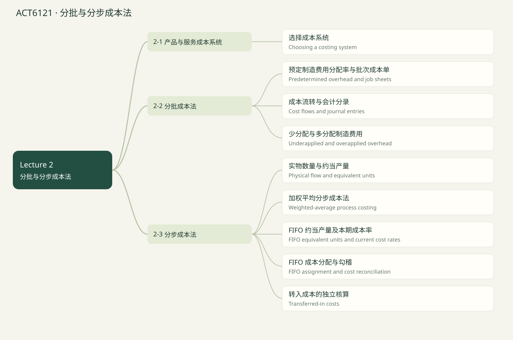

# ACT6121 · 分批与分步成本法 / Job & process costing

覆盖当前已上传 Lecture 1–5 的知识点；case study 文件夹未读取。Lecture 1课程大纲提到 life-cycle costs，但尚无该章课件，因此未假定已经讲完或排除出最终考试。后续上传后可新增章节。页码均指PDF文件页序，不是幻灯片页脚编号。

## 知识点清单

- [ ] 选择成本系统 / Choosing a costing system

- [ ] 预定制造费用分配率与批次成本单 / Predetermined overhead and job sheets

- [ ] 成本流转与会计分录 / Cost flows and journal entries

- [ ] 少分配与多分配制造费用 / Underapplied and overapplied overhead

- [ ] 实物数量与约当产量 / Physical flow and equivalent units

- [ ] 加权平均分步成本法 / Weighted-average process costing

- [ ] FIFO 约当产量及本期成本率 / FIFO equivalent units and current cost rates

- [ ] FIFO 成本分配与勾稽 / FIFO assignment and cost reconciliation

- [ ] 转入成本的独立核算 / Transferred-in costs

## 选择成本系统 / Choosing a costing system

来源：Lecture 2 PDF 8–16, 69–72, 132–134

分批成本法用于不同客户或批次的异质产品，按 job 累积成本，再除以该 job 产量。分步成本法用于连续、大量同质产品，按部门或工序累积并平均。两者都处理 DM、DL、MOH，并使用 RM、WIP、FG 账户。

服务企业也需要成本信息用于报价和控制，例如建筑设计项目、医疗服务；不应因为服务通常不能储存就认为无需成本系统。

Operation costing 是混合系统：不同系列的材料分别追溯，共用工序的加工成本平均分配。AI 可自动归集和追踪，但成本对象、分配基础、WA/FIFO 政策仍须选择。

Job costing accumulates by job; process costing accumulates by department for homogeneous output. Operation costing combines both.

**Formula:** Job unit cost = Job total cost / Units in job

**易错点：** 方法取决于生产流程和异质性，不只取决于公司大小。

### 讲解例题 / Worked example

A custom wedding caterer most likely uses:

定制婚宴服务最可能使用：

1. Job-order costing

分批成本法
2. Process costing only

仅分步成本法

**解析 / Solution**

Each customer order has distinct requirements.

各客户订单要求不同。

## 预定制造费用分配率与批次成本单 / Predetermined overhead and job sheets

来源：Lecture 2 PDF 18–36, 39–42

材料领用单追踪 DM，工时记录追踪 DL，批次成本单汇集 DM、DL 和 applied MOH。MOH 难以直接追溯，需选择能解释资源消耗的分配基础。

期初预定率 POHR = 预计 MOH / 预计分配基础总量；本期某 job 分配额 = POHR × 该 job 实际使用基础量。分子若含固定和变动部分，先算 a + b × estimated activity。

预定率让报价及时并减少季节性波动。批次平均单位成本含固定费用分摊，不等于多生产一件的边际成本。

Use estimated totals to set the rate, then actual job activity to apply overhead.

**Formula:** POHR = Estimated MOH / Estimated base; Job cost = DM + DL + POHR × actual job base

**易错点：** 期初率用预计基础；分配到 job 时用实际基础。

### 讲解例题 / Worked example

Estimated MOH $640,000; estimated DLH 160,000. Find POHR.

预计 MOH 640,000、DLH 160,000，求 POHR。

Unit / 单位：$/DLH

**解析 / Solution**

640,000 / 160,000 = $4 per DLH.

640,000 / 160,000 = 每 DLH 4。

## 成本流转与会计分录 / Cost flows and journal entries

来源：Lecture 2 PDF 43–57

购入材料：Dr RM / Cr AP。领用 DM：Dr WIP / Cr RM；间接材料：Dr MOH / Cr RM。直接人工借记 WIP，间接人工借记 MOH，贷记应付工资。

实际其他制造费用借记 MOH；分配制造费用 Dr WIP / Cr MOH。MOH 是清算账户：借方实际、贷方分配，期末差额需要处理。

完工 Dr FG / Cr WIP；销售需两笔：Dr AR / Cr Sales，以及 Dr COGS / Cr FG。未完工留在 WIP，未售出完工品留在 FG。

Actual overhead is debited to MOH; applied overhead is credited to MOH and debited to WIP.

**Formula:** RM → WIP → FG → COGS

**易错点：** 完工不等于销售；记录收入并不会自动结转成本。

### 讲解例题 / Worked example

A completed job costs $10,000 for 100 units. Sell 60 units. Find COGS.

完工批次 100 件成本 10,000，售出 60 件，求 COGS。

Unit / 单位：$

**解析 / Solution**

Unit cost = 100; COGS = 60 × 100 = 6,000.

单位成本 100；COGS = 6,000。

## 少分配与多分配制造费用 / Underapplied and overapplied overhead

来源：Lecture 2 PDF 58–68

实际 MOH > 分配 MOH 是 underapplied，MOH 借方余额；实际 < 分配是 overapplied，贷方余额。差异可能来自预算成本、活动量或基础选择。

简化处理结转 COGS：少分配增加 COGS、减少利润；多分配减少 COGS、增加利润。若分摊到 WIP、FG、COGS，依题目要求，课件按各账户内已分配 MOH 比例，而不是随意按总余额。

结转后 MOH 清零。核对差异方向，再写借贷，避免靠背诵符号。

Underapplied overhead increases COGS when closed out; overapplied overhead decreases it.

**Formula:** Underapplied amount = Actual MOH − Applied MOH

**易错点：** 分摊基数是各账户中的 applied MOH，除非题目另有指定。

### 讲解例题 / Worked example

Actual MOH $1,210,000; rate $4; actual MH 290,000. Find underapplied MOH.

实际 MOH 1,210,000，率 4，实际 MH 290,000，求少分配额。

Unit / 单位：$

**解析 / Solution**

Applied = 1,160,000; actual − applied = 50,000.

分配 1,160,000；少分配 50,000。

## 实物数量与约当产量 / Physical flow and equivalent units

来源：Lecture 2 PDF 72–90

分步成本法为每个加工部门建立 WIP。转出 A 部门的成本借记 WIP-B、贷记 WIP-A；末部门完工转 FG。

先核对实物：期初 WIP + 本期投入 = 转出 + 期末 WIP。约当产量 EU 把部分完工数量换成完整工作量，必须对材料、加工成本分别算。

材料可能在开始或末尾一次投入，加工成本通常持续发生。400 件已投入全部材料、加工 20%，材料 EU 400、加工 EU 80。不要用同一完成度乘所有成本。

Equivalent units measure work, not physical units. Completion percentages differ by cost category.

**Formula:** EU in ending WIP = Physical units × Completion %

**易错点：** 期末实物 600 件不一定等于材料 EU 600。

### 讲解例题 / Worked example

400 units are 20% complete for conversion. Find conversion EU.

400 件加工完成 20%，求加工 EU。

Unit / 单位：EU

**解析 / Solution**

400 × 20% = 80.

400 × 20% = 80。

## 加权平均分步成本法 / Weighted-average process costing

来源：Lecture 2 PDF 90–110, 135–142

WA 把期初与本期成本混合。步骤一：转出数量 + 期末 EU；步骤二：期初成本 + 本期投入成本，除以 WA EU；步骤三：分配给转出及期末；步骤四：成本勾稽。

期初完成百分比不从 WA EU 中扣除，因为分子也包含前期成本。转出的每件对本部门通常按 100% 完工处理。

材料与加工分别算单位 EU 成本，期末 WIP = 材料 EU × 材料率 + 加工 EU × 加工率。不要用总实物数直接分所有成本。

WA combines beginning and current costs and divides by transferred-out units plus ending equivalent units.

**Formula:** WA rate = (Beginning cost + Added cost) / (Transferred units + Ending EU)

**易错点：** 不能把 WA 的成本分子与 FIFO 的 EU 分母混用。

### 讲解例题 / Worked example

Transferred 5,400; ending 900 at 60% materials. Find WA material EU.

转出 5,400；期末 900，材料完成 60%，求 WA 材料 EU。

Unit / 单位：EU

**解析 / Solution**

5,400 + 900 × .60 = 5,940.

5,400 + 540 = 5,940。

## FIFO 约当产量及本期成本率 / FIFO equivalent units and current cost rates

来源：Lecture 2 PDF 111–122

FIFO 只计量本期完成的工作。EU = 完成期初尚未完成部分 + 本期开始并完成 + 期末 EU。若期初全部先完成，本期开始并完成 = 转出 − 期初数量。

等价写法：FIFO EU = 转出 + 期末 EU − 期初已完成 EU。材料与加工各自扣除期初已完成工作量。

成本率分子只用本期新增成本。FIFO 更能反映当期成本变化；WA 的低成本期初存货可能掩盖本期上涨。

FIFO separates current-period work and cost from prior-period work and cost.

**Formula:** FIFO EU = Transferred + Ending EU − Beginning EU; rate = Current added cost / FIFO EU

**易错点：** 期初材料 100% 完成，则本期完成期初材料 EU 为 0。

### 讲解例题 / Worked example

Transferred 5,400; end 900 at 60%; beginning 300 at 40%. Find FIFO material EU.

转出 5,400；期末 900 完成 60%；期初 300 完成 40%，求 FIFO 材料 EU。

Unit / 单位：EU

**解析 / Solution**

5,400 + 540 − 120 = 5,820.

5,400 + 540 − 120 = 5,820。

## FIFO 成本分配与勾稽 / FIFO assignment and cost reconciliation

来源：Lecture 2 PDF 123–131, 143–147

FIFO 转出成本分三块：期初已累计成本 + 本期完成期初的成本 + 本期开始并完成的成本。期初已经发生的成本不能丢掉，也不能重新按本期率计价。

期末成本 = 各成本类别期末 EU × 本期成本率。最后核对：期初成本 + 本期新增 = 转出成本 + 期末成本。

保留中间精度，最后再舍入；逐行舍入可能有 1 元差异，应说明。WA 与 FIFO 比较要同时解释成本和产量口径。

FIFO transferred-out cost preserves beginning cost and adds only the current work needed to finish it.

**Formula:** Beginning cost + Added cost = Transferred cost + Ending WIP cost

**易错点：** 只算“本期率 × 全部转出数量”会漏掉或错误重算期初成本。

### 讲解例题 / Worked example

Beginning cost $13,400; finish-beginning cost $10,360; started/completed cost $345,000. Find FIFO transferred cost.

期初成本 13,400；完成期初新增 10,360；本期开始并完成 345,000，求 FIFO 转出成本。

Unit / 单位：$

**解析 / Solution**

13,400 + 10,360 + 345,000 = 368,760.

13,400 + 10,360 + 345,000 = 368,760。

## 转入成本的独立核算 / Transferred-in costs

来源：Lecture 2 PDF 79–84; Tutorial 1 Q3

后续部门应单独列 transferred-in costs，它代表上一部门已完成并转来的成本，不等于本部门新增材料。

某单位进入本部门时，相对上一部门的工作通常已 100% 完成，因此本部门期末 WIP 的转入成本完成度为 100%，即使本部门材料尚未投入。

Tutorial 1 Q3：转出 1,800、期末 600；WA 转入 EU 2,400，材料 EU 1,800，加工 EU 2,010。三类成本分别算率，再分别分配。

Transferred-in costs are a separate category; units already in the receiving department are 100% complete for the prior department’s work.

**Formula:** WA transferred-in EU = Transferred-out units + Ending physical units

**易错点：** 本部门加工 35% 不意味着转入成本也只完成 35%。

### 讲解例题 / Worked example

Transferred-in cost $22,008; transferred 1,800 and ending 600. Find WA transferred-in rate.

转入总成本 22,008，转出 1,800，期末 600，求 WA 转入成本率。

Unit / 单位：$/EU

**解析 / Solution**

22,008 / 2,400 = 9.17.

22,008 / 2,400 = 9.17。

## 章节练习 / Chapter exercises

以下先列出全部题目，后附所有答案。

### 1. Gitano: overhead, COGM and COGS

Gitano：制造费用、完工与销售成本

Tutorial 1 Q2，题目 p.2；答案 pp.3–5；Excel Q2（重述 / Restated；第5问为补充）

Estimated MOH $800,000; estimated DM usage $500,000. Allocate on DM USED. Actual purchases $510,000, DL $90,000; actual MOH: indirect labor $170,000, property tax $48,000, depreciation $260,000, maintenance $95,000, insurance $7,000, rent $180,000. Beginning/ending inventories: RM $20,000/$80,000; WIP $150,000/$70,000; FG $260,000/$400,000. All materials used are direct.
Find (1) POHR, (2) under/overapplied MOH, (3) COGM, (4) unadjusted COGS and disposal alternatives, (5) adjusted COGS if all variance is closed to COGS.

预计MOH800,000、预计DM耗用500,000，按DM实际耗用分配。实际采购510,000、DL90,000；实际MOH：间接人工170,000、税48,000、折旧260,000、维护95,000、保险7,000、租金180,000。期初/期末：RM20,000/80,000；WIP150,000/70,000；FG260,000/400,000。材料全部直接。
求（1）预定率（2）少/多分配（3）COGM（4）未调整COGS及差异处理（5）全部差异结转COGS后的金额。

### 2. Provost: weighted average with transferred-in cost

Provost：含转入成本的加权平均

Tutorial 1 Q3，题目 p.3；答案 pp.5–6；Excel Q3（重述 / Restated）

Finishing department uses WA. Beginning WIP 450 units: transferred-in cost $4,068, materials $1,980, conversion $2,160 (materials 100%, conversion 60%). Received 1,950 units with transferred-in cost $17,940. Added materials $6,210 and conversion $13,920. Transferred out 1,800; ending WIP 600 (materials 0%, conversion 35%). An assistant charged all $46,278 to the 1,800 units ($25.71 each), leaving zero WIP.
Compute EUs and rates for all three categories, costs transferred and ending WIP, and explain the error.

Finishing部门用WA。期初450件：转入成本4,068、材料1,980、加工2,160（材料100%、加工60%）。本期转入1,950件，成本17,940；新增材料6,210、加工13,920。转出1,800；期末600件（材料0%、加工35%）。助理将全部46,278分给1,800完工件，每件25.71，期末WIP记零。
计算三类EU、成本率、转出和期末成本，并解释错误。

### 3. Selzik: complete FIFO production report

Selzik：完整FIFO成本报告

Tutorial 1 Q4，题目 p.4；答案 pp.7–8；Excel Q4（重述 / Restated）

Beginning WIP 10,000 units (materials 100%, conversion 30%) with materials $8,500 and conversion $4,900. Started 170,000; ending WIP 20,000 (materials 100%, conversion 40%). Added materials $139,400 and conversion $244,200. Materials enter at the start. Use FIFO.
Compute transferred units, EUs, current rates, ending WIP, transferred costs by component and the reconciliation.

期初WIP10,000件（材料100%、加工30%），成本材料8,500、加工4,900。本期投入170,000；期末20,000件（材料100%、加工40%）。新增材料139,400、加工244,200。材料开始加入，使用FIFO。
求转出件数、EU、当期率、期末WIP、转出成本分解及勾稽。

### 4. Choosing a costing system

选择成本系统

原创基础题 / Original drill · 与模卡复测共享题目

Do job and process costing use the same basic inventory accounts?
1. Yes
2. No

两种成本法使用相同基本存货账户吗？
1. 是
2. 否

### 5. Predetermined overhead and job sheets

预定制造费用分配率与批次成本单

原创基础题 / Original drill · 与模卡复测共享题目

Fixed MOH $120,000 plus $3 per MH, estimated 40,000 MH. A job uses 100 MH, DM $200, DL $300. Find job cost.

固定 MOH 120,000，变动 3/MH，预计 40,000 MH；job 用 100 MH、DM 200、DL 300，求总成本。

### 6. Cost flows and journal entries

成本流转与会计分录

原创基础题 / Original drill · 与模卡复测共享题目

A job of 200 units costs $24,000. 150 are sold. Find ending FG.

200 件成本 24,000，售出 150 件，求期末 FG。

### 7. Underapplied and overapplied overhead

少分配与多分配制造费用

原创基础题 / Original drill · 与模卡复测共享题目

Unadjusted COGS $1,200,000 and underapplied MOH $40,000, all closed to COGS. Find adjusted COGS.

未调整 COGS 1,200,000，少分配 40,000 全部结转 COGS，求调整后金额。

### 8. Physical flow and equivalent units

实物数量与约当产量

原创基础题 / Original drill · 与模卡复测共享题目

Ending WIP 600 units, conversion 35% complete. Find ending conversion EU.

期末 WIP 600 件，加工 35%，求期末加工 EU。

### 9. Weighted-average process costing

加权平均分步成本法

原创基础题 / Original drill · 与模卡复测共享题目

End material EU 540 at $21, conversion EU 270 at $15. Find ending WIP cost.

期末材料 EU 540、率 21；加工 EU 270、率 15，求期末 WIP。

### 10. FIFO equivalent units and current cost rates

FIFO 约当产量及本期成本率

原创基础题 / Original drill · 与模卡复测共享题目

Current conversion cost $244,200; FIFO conversion EU 165,000. Find cost per EU.

本期加工成本 244,200；FIFO 加工 EU 165,000，求单位 EU 成本。

### 11. FIFO assignment and cost reconciliation

FIFO 成本分配与勾稽

原创基础题 / Original drill · 与模卡复测共享题目

End materials EU 720 at $6.30; conversion EU 160 at $26.90. Find ending WIP.

期末材料 EU 720、率 6.30；加工 EU 160、率 26.90，求期末 WIP。

### 12. Transferred-in costs

转入成本的独立核算

原创基础题 / Original drill · 与模卡复测共享题目

Transferred-in, materials and conversion rates are $9.17, $4.55 and $8. Find cost of 1,800 finished units.

转入、材料、加工率分别 9.17、4.55、8，求 1,800 完工件成本。

---

## 全部答案与解析 / Collected solutions

### 1. Gitano: overhead, COGM and COGS

Gitano：制造费用、完工与销售成本

1. POHR = 800,000/500,000 = 160% of DM used.
2. DM used = 20,000+510,000−80,000 = 450,000. Applied MOH = 720,000. Actual MOH = 760,000. Underapplied = 40,000.
3. Manufacturing costs added = 450,000+90,000+720,000 = 1,260,000. COGM = 150,000+1,260,000−70,000 = 1,340,000.
4. COGS = 260,000+1,340,000−400,000 = 1,200,000. Close variance to COGS, or allocate among WIP/FG/COGS based on applied MOH contained in them.
5. Adjusted COGS = 1,240,000. Dr COGS 40,000; Cr MOH 40,000.

1. 800,000/500,000 = DM耗用的160%。
2. DM耗用20,000+510,000−80,000=450,000；分配MOH720,000；实际MOH760,000；少分配40,000。
3. 本期制造投入450,000+90,000+720,000=1,260,000；COGM150,000+1,260,000−70,000=1,340,000。
4. 未调整COGS260,000+1,340,000−400,000=1,200,000。差异可全部结转COGS或按各账户内分配MOH比例分到WIP/FG/COGS。
5. 调整后COGS1,240,000；借COGS40,000、贷MOH40,000。

### 2. Provost: weighted average with transferred-in cost

Provost：含转入成本的加权平均

Physical flow: 450+1,950 = 1,800+600.
EU: transferred-in 2,400; materials 1,800; conversion 1,800+600×35%=2,010.
Costs: 22,008 / 8,190 / 16,080. Rates: 9.17 / 4.55 / 8.00.
Ending WIP: 600×9.17 + 0×4.55 + 210×8 = 7,182.
Transferred: 1,800×(9.17+4.55+8) = 39,096, or $21.72/unit.
Reconcile 7,182+39,096=46,278. The assistant incorrectly assigned the cost of incomplete units to finished units. Ending materials are zero, but transferred-in and conversion costs are not zero.

实物流：450+1,950=1,800+600。
EU：转入2,400；材料1,800；加工1,800+600×35%=2,010。
总成本分别22,008/8,190/16,080；单位率9.17/4.55/8.00。
期末WIP=600×9.17+0×4.55+210×8=7,182。
转出=1,800×21.72=39,096，每件21.72。
勾稽7,182+39,096=46,278。助理把未完工产品的成本全部转给完工产品；期末材料为零不代表转入和加工成本也为零。

### 3. Selzik: complete FIFO production report

Selzik：完整FIFO成本报告

Transferred = 10,000+170,000−20,000 = 160,000; started and completed = 150,000.
FIFO materials EU = 0+150,000+20,000 = 170,000; conversion EU = 7,000+150,000+8,000 = 165,000.
Rates: materials .82; conversion 1.48.
Ending WIP = 20,000×.82 + 8,000×1.48 = 28,240.
Transferred: beginning cost 13,400; finish beginning 7,000×1.48=10,360; started/completed 150,000×2.30=345,000. Total 368,760 (materials 131,500; conversion 237,260).
Reconcile 13,400+383,600 = 397,000 = 28,240+368,760.

转出10,000+170,000−20,000=160,000；本期开始并完成150,000。
FIFO材料EU=0+150,000+20,000=170,000；加工EU=7,000+150,000+8,000=165,000。
材料率.82、加工率1.48。
期末20,000×.82+8,000×1.48=28,240。
转出：期初13,400 + 完成期初7,000×1.48=10,360 + 本期开始完成150,000×2.30=345,000；合计368,760（材料131,500；加工237,260）。
勾稽13,400+383,600=397,000=28,240+368,760。

### 4. Choosing a costing system

选择成本系统

Yes
Both use RM, WIP and FG.

是
两者都使用 RM、WIP、FG。

### 5. Predetermined overhead and job sheets

预定制造费用分配率与批次成本单

1100 $
POHR = (120,000 + 3 × 40,000)/40,000 = 6; job = 200 + 300 + 600 = 1,100.

1100 $
POHR = 6；总成本 = 200 + 300 + 600 = 1,100。

### 6. Cost flows and journal entries

成本流转与会计分录

6000 $
50 unsold × $120 = $6,000.

6000 $
未售 50 件 × 单位成本 120 = 6,000。

### 7. Underapplied and overapplied overhead

少分配与多分配制造费用

1240000 $
1,200,000 + 40,000 = 1,240,000.

1240000 $
少分配增加 COGS：1,240,000。

### 8. Physical flow and equivalent units

实物数量与约当产量

210 EU
600 × .35 = 210.

210 EU
600 × .35 = 210。

### 9. Weighted-average process costing

加权平均分步成本法

15390 $
540 × 21 + 270 × 15 = 15,390.

15390 $
11,340 + 4,050 = 15,390。

### 10. FIFO equivalent units and current cost rates

FIFO 约当产量及本期成本率

1.48 $/EU
244,200 / 165,000 = 1.48.

1.48 $/EU
244,200 / 165,000 = 1.48。

### 11. FIFO assignment and cost reconciliation

FIFO 成本分配与勾稽

8840 $
720 × 6.3 + 160 × 26.9 = 8,840.

8840 $
4,536 + 4,304 = 8,840。

### 12. Transferred-in costs

转入成本的独立核算

39096 $
1,800 × (9.17 + 4.55 + 8) = 39,096.

39096 $
1,800 × 21.72 = 39,096。

## 课件核对说明

Ruger 期初 WIP 未计入课件结转数字

Lecture 2 PDF p.43给出Job A期初30,000；pp.46、48、52分别加DM30,000、DL35,000、MOH60,000，因此总额155,000。p.55写125,000，似遗漏期初30,000；同理Job B=20,000+25,000+30,000=75,000。若A共1,000件售750件，按完整数据COGS116,250、期末FG38,750，而p.57用125,000算93,750。复习采用保留期初余额的计算，并建议课堂核实。

FIFO 公式与算例精度

PDF p.120提取出的公式可能仍显示期初成本，但p.122数表及FIFO定义只用本期新增成本。p.130的一元勾稽差异来自中间舍入。Sunspot pp.136–138：25,200+24,900=50,100，而p.138写50,000；24,900+238,700=263,600，而p.136写263,500。按所列输入总额为623,600，按课件答案为623,500，存在100差异。该例不直接用于自动判分，需向老师确认输入。

背景案例与成本架构

PDF pp.2–7采购承诺与套期保值案例用来说明投入价格波动及成本滞后，不作为未来行情预测。pp.91、133强调AI追踪批次可改善数据，但混料、共同加工资源和成本对象选择仍需要会计政策。

## 思维导图

