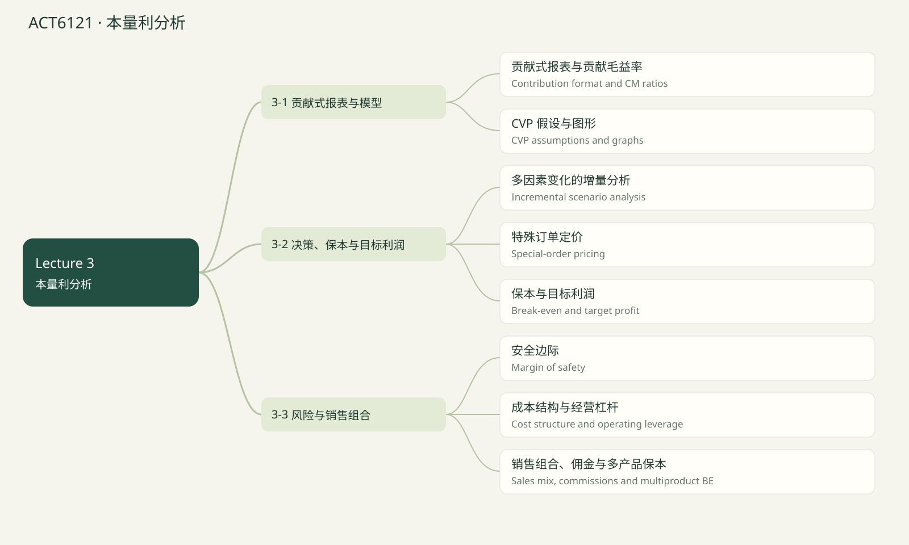

# ACT6121 · 本量利分析 / Cost–volume–profit

覆盖当前已上传 Lecture 1–5 的知识点；case study 文件夹未读取。Lecture 1课程大纲提到 life-cycle costs，但尚无该章课件，因此未假定已经讲完或排除出最终考试。后续上传后可新增章节。页码均指PDF文件页序，不是幻灯片页脚编号。 2024历年卷训练已融合：原卷14题及14道变式；价值指数单列补充，不冒充已上传Lecture。

## 知识点清单

- [ ] 贡献式报表与贡献毛益率 / Contribution format and CM ratios

- [ ] CVP 假设与图形 / CVP assumptions and graphs

- [ ] 多因素变化的增量分析 / Incremental scenario analysis

- [ ] 特殊订单定价 / Special-order pricing

- [ ] 保本与目标利润 / Break-even and target profit

- [ ] 安全边际 / Margin of safety

- [ ] 成本结构与经营杠杆 / Cost structure and operating leverage

- [ ] 销售组合、佣金与多产品保本 / Sales mix, commissions and multiproduct BE

## 贡献式报表与贡献毛益率 / Contribution format and CM ratios

来源：Lecture 3 PDF 2–4, 14–24, 33–40

传统利润表按功能区分 COGS 和 S&A，毛利 = 销售 − COGS。贡献式按成本行为分类，CM = 销售 − 所有变动费用，既含变动制造费用，也含变动销售管理费用。

CM 先覆盖固定费用，剩余才是 NOI。单位 CM = P − V；CM ratio = CM / Sales = (P − V)/P；变动费用率 = 1 − CM ratio。

成本结构不变时，销售额变化 × CM ratio = CM 变化；固定成本不变时也是利润变化。

Contribution margin deducts all variable expenses, not just variable manufacturing costs.

**Formula:** NOI = Q(P − V) − F = Sales × CMR − F

**易错点：** 贡献毛益不是毛利，也不是净利润。

### 讲解例题 / Worked example

Price $500, total variable cost $300/unit. Find CM ratio in percent.

售价 500、单位全部变动成本 300，求 CM 率百分数。

Unit / 单位：%

**解析 / Solution**

(500 − 300)/500 × 100 = 40%.

200/500 = 40%。

## CVP 假设与图形 / CVP assumptions and graphs

来源：Lecture 3 PDF 7–13, 25–32

CVP 分析售价、销量、单位变动成本、固定成本和销售组合对利润的影响。标准模型在相关范围内假设售价和单位变动成本不变、总固定成本不变；多产品销售组合不变。课件制造业简化假设生产等于销售。

CVP 图横轴销量，纵轴金额；收入线从原点出发，斜率 P；总成本线截距 F、斜率 V；相交点为保本。利润图截距 −F，斜率单位 CM。

跨容量台阶、大幅降价改变需求、多期投资或组合改变时，应重新估计模型，不能机械外推。

CVP is a linear model valid within its relevant range; changing price or mix requires recalculation.

**Formula:** Revenue = PQ; Total cost = F + VQ; Profit = (P − V)Q − F

**易错点：** 总成本线不从原点出发，除非 F = 0。

### 讲解例题 / Worked example

P $50, V $30, F $8,000. Find profit at Q = 500.

P 50，V 30，F 8,000，Q 500 时求利润。

Unit / 单位：$

**解析 / Solution**

(50 − 30) × 500 − 8,000 = 2,000.

20 × 500 − 8,000 = 2,000。

## 多因素变化的增量分析 / Incremental scenario analysis

来源：Lecture 3 PDF 41–53

同时变动售价、变动成本、销量和固定费用时，最稳妥的方法是分别算新旧 NOI，再相减。不要只计算新增销量的 CM，因为降价或成本上涨可能影响全部销量。

广告方案：增加 CM 减去增加固定广告费。材料升级：新单位 CM 乘新销量，减旧总 CM。工资改佣金：降低 F，但佣金加入每单位 V。

列出 ΔP、ΔV、ΔQ、ΔF，说明其他条件不变。结果为正才表示该简化模型下有利，仍需考虑产能和需求假设。

Recompute the full contribution under the new scenario, then subtract changes in fixed expenses.

**Formula:** ΔNOI = (P₁ − V₁)Q₁ − (P₀ − V₀)Q₀ − (F₁ − F₀)

**易错点：** 单位成本变化通常作用于全部新销量，不只新增销量。

### 讲解例题 / Worked example

Unit CM $200; advertising adds $10,000 and raises sales by 40 units. Find ΔNOI.

单位 CM 200，广告增加 10,000，使销量增加 40，求 ΔNOI。

Unit / 单位：$

**解析 / Solution**

40 × 200 − 10,000 = −2,000.

8,000 − 10,000 = −2,000。

## 特殊订单定价 / Special-order pricing

来源：Lecture 3 PDF 54–55

有闲置产能且不影响原有销量、不增加固定费用时，额外订单报价需覆盖相关单位变动成本，加上每单位目标增量利润。原有固定费用通常不因该订单变化。

若有额外设置费、运费、佣金或机会成本，须纳入。产能满载时的报价底线不能只用 V，因为订单可能挤出正常订单。

这是短期增量分析，不意味着长期价格可以永久低于全部成本。

With spare capacity and no displacement, quote relevant variable cost plus required incremental profit per unit.

**Formula:** Price = Relevant V + (Extra fixed cost + Opportunity cost + Target profit) / Order units

**易错点：** 必须明确闲置产能、无挤出和额外成本假设。

### 讲解例题 / Worked example

150 extra bikes; V $300; desired extra profit $3,000; no other effects. Find price.

额外 150 辆，V 300，目标增量利润 3,000，无其他影响，求报价。

Unit / 单位：$/unit

**解析 / Solution**

300 + 3,000/150 = 320.

300 + 20 = 320。

## 保本与目标利润 / Break-even and target profit

来源：Lecture 3 PDF 56–74

保本令 NOI = 0：保本数量 = F / 单位 CM；保本销售额 = F / CMR。目标利润 T 时，分子改为 F + T。数量公式分母是每单位金额，销售额公式分母是比率。

不可分割商品若要求至少达到目标，结果要向上取整，不是四舍五入。保本理论值可保留小数，并分别说明实际最低整数销量。

先用未舍入的 CMR 算，最后舍入。若单位 CM ≤ 0 且 F > 0，增加销量无法用通常公式达到正利润。

Use unit CM for quantities and CM ratio for revenue; round indivisible required units upward.

**Formula:** Qtarget = (F + T)/(P − V); Sales target = (F + T)/CMR

**易错点：** 课件咖啡保本 1,150 是近似；1,300/1.13 = 1,150.442…，实际至少 1,151 杯。

### 讲解例题 / Worked example

F $80,000; unit CM $200; target $100,000. Required units?

F 80,000、单位 CM 200、目标利润 100,000，需要多少件？

Unit / 单位：units

**解析 / Solution**

(80,000 + 100,000)/200 = 900.

180,000/200 = 900。

## 安全边际 / Margin of safety

来源：Lecture 3 PDF 76–81

安全边际表示销售还能下降多少才到保本点。金额 = 实际或预算销售额 − 保本销售额；比率 = 安全边际 / 实际或预算销售额。单一产品可换算件数。

分母是实际/预算销售，不是保本销售。负安全边际表示已经低于保本点。

成本结构不变时 NOI = MOS dollars × CMR；可用来交叉核对。用理论保本数量和取整后的最低销量时，要说明精度口径。

Margin of safety measures the sales cushion above break-even.

**Formula:** MOS% = (Sales − BE sales) / Sales

**易错点：** 安全边际率不是利润率；两者相差 CM 率。

### 讲解例题 / Worked example

Actual sales $250,000; BE sales $200,000. MOS percent?

实际销售 250,000，保本 200,000，安全边际百分数？

Unit / 单位：%

**解析 / Solution**

(250,000 − 200,000)/250,000 = 20%.

50,000/250,000 = 20%。

## 成本结构与经营杠杆 / Cost structure and operating leverage

来源：Lecture 3 PDF 82–95

高固定、低变动结构在需求旺盛时可能更有利润，但销量下滑时风险更大；外包可能将部分固定支出变成按量支付，但需考虑质量与长期容量。

DOL = CM / NOI，基于当前销量计算。成本与售价不变时，利润百分比变化 = DOL × 销量百分比变化。接近保本且盈利时 DOL 很大；NOI = 0 时比值未定义。

在标准 CVP 模型且利润为正时 DOL = 1 / MOS%。随销量提高 DOL 通常下降，不是公司永久固定常数。

Operating leverage measures profit sensitivity at a specific sales level; it is undefined at zero operating income.

**Formula:** DOL = CM / NOI; %ΔNOI = DOL × %ΔSales

**易错点：** 不能把当前 DOL 当作所有销量下都一样，也不能在亏损区机械解释为常规风险倍数。

### 讲解例题 / Worked example

CM $100,000, NOI $20,000. Find DOL.

CM 100,000，NOI 20,000，求 DOL。

Unit / 单位：times

**解析 / Solution**

100,000/20,000 = 5.

100,000/20,000 = 5。

## 销售组合、佣金与多产品保本 / Sales mix, commissions and multiproduct BE

来源：Lecture 3 PDF 96–105

多个产品的 CMR 不同，总体 CMR = 总 CM / 总销售额，也等于按销售额占比加权的 CMR。销售组合固定时，总体保本销售额 = 总 F / 总体 CMR。

如果给的是销量组合，先构造组合包或按销量加权单位 CM；不能把销量占比直接乘收入 CM 率。销售往低贡献产品偏移可能降低利润，即使总销售额不变。

课件 BE ratio = F / 总 CM = 1 − MOS%，用其乘各产品当前销售额可求固定组合下各产品保本收入。佣金按销售额可能鼓励高售价低 CM 产品，应关注激励一致性。

Weight CM ratios by revenue shares; the sales mix must stay constant for the computed break-even point.

**Formula:** Weighted CMR = Σ(revenue share × product CMR); BE ratio = F / Total CM

**易错点：** 不要混用精确销售额比例和课件近似的 45%/55%。

### 讲解例题 / Worked example

Revenue mix A 40%, B 60%; CMR A 30%, B 50%. Weighted CMR percent?

收入组合 A 40%、B 60%；CMR 分别 30%、50%，求加权 CMR 百分数。

Unit / 单位：%

**解析 / Solution**

.4 × .3 + .6 × .5 = .42.

.12 + .30 = .42，即 42%。

## 章节练习 / Chapter exercises

以下先列出全部题目，后附所有答案。

### 1. 2024 A1 · Revenue versus volume

2024 A1 · Revenue versus volume

2024 原题 · 2分 · 用户提供的期中答案卷；英文题面保留实质内容，表格转写 / Past-paper question

Holding constant a firm’s cost structure (unit variable cost and total fixed cost), what will happen for sure if the firm’s sales revenue increases?
A) The total variable cost will increase.
B) The break-even point in units will decrease.
C) The margin of safety percentage will decrease.
D) None of the above is correct.

单位变动成本和总固定成本不变，销售收入增加时哪项一定成立？
A 总变动成本增加；B 保本件数下降；C 安全边际率下降；D 以上均不一定。

### 2. Variation · A1

变式训练 · A1

2024 A1 原创变式 · 训练参考分值2分 / Original variation

With P=$50,V=$30,F=$8,000,Q=500, price rises to $55 while volume is unchanged. Find total VC, BE units (theoretical), MOS% and NOI.

P50、V30、F8,000、Q500，提价到55而销量不变。求总VC、理论保本量、MOS%和NOI。

### 3. 2024 A4 · Risk ratios

2024 A4 · Risk ratios

2024 原题 · 2分 · 用户提供的期中答案卷；英文题面保留实质内容，表格转写 / Past-paper question

Which ratio statement is incorrect?
A High DOL means less stable earnings.
B High DOL benefits more from increased sales.
C High MOS% benefits less from increased sales.
D High MOS% makes losses from sales drops more likely.

哪项比率表述错误？A 高DOL收益更不稳定；B 高DOL更受益于销量增加；C 高MOS%利润对销量增加较不敏感；D 高MOS%因销量下降更易亏损。

### 4. Variation · A4

变式训练 · A4

2024 A4 原创变式 · 训练参考分值2分 / Original variation

Firms have MOS20% and40%. Under stable profitable CVP, find both DOLs and predicted profit% change after a5% volume decline.

两公司MOS20%、40%，求各DOL以及销量下降5%时利润百分比变化。

### 5. 2024 B1 · MOS dollars

2024 B1 · MOS dollars

2024 原题 · 2分 · 用户提供的期中答案卷；英文题面保留实质内容，表格转写 / Past-paper question

Sales$180,000, variable expense ratio60%, fixed expenses$45,000. Find margin of safety in dollars.

销售180,000、变动费用率60%、F45,000，求安全边际金额。

### 6. Variation · B1

变式训练 · B1

2024 B1 原创变式 · 训练参考分值2分 / Original variation

Sales$240,000, variable ratio65%, F$63,000. Find MOS dollars and MOS%.

销售240,000、变动率65%、F63,000，求MOS金额及百分比。

### 7. 2024 B3 · Infer DOL from changes

2024 B3 · Infer DOL from changes

2024 原题 · 2分 · 用户提供的期中答案卷；英文题面保留实质内容，表格转写 / Past-paper question

East sales decline from$100,000 to$80,000; NOI declines300%. Find the initial DOL.

收入从100,000降至80,000，NOI下降300%，求原DOL。

### 8. Variation · B3

变式训练 · B3

2024 B3 原创变式 · 训练参考分值2分 / Original variation

Revenue declines from$200,000 to$170,000 at unchanged price; NOI falls120%. Infer initial DOL and MOS%.

售价不变，收入200,000降至170,000；利润下降120%，反推DOL与MOS%。

### 9. Northwood: CVP and automation

Northwood：CVP与自动化方案

Tutorial 2 Q1，PDF p.1（重述；未提供官方答案，本解答独立复算 / Independently derived）

Basketball price $25; variable expense $15 (60% is direct labor); sales 30,000; F $210,000. Original sales $750,000, CM $300,000, NOI $90,000.
1. Compute CMR, BE units and DOL.
2. V rises by $3, price stays $25. Compute CMR and BE units.
3. Under (2), find minimum whole sales units for NOI $90,000.
4. Under (2), find price needed to keep the ORIGINAL CMR.
5. Return to original data. Automation cuts V by 40% and doubles F. Compute CMR and BE units.
6. Under automation: (a) minimum whole sales units for NOI $90,000; (b) contribution statement and DOL at 30,000 units; (c) advise whether to automate, explaining demand risk.

篮球售价25，变动费用15（其中60%是直接人工），销量30,000，F210,000。原收入750,000、CM300,000、NOI90,000。
1. 求CMR、保本销量、DOL。
2. V增加3，售价不变，求新CMR和保本销量。
3. 按第2问，要赚90,000至少卖多少整件？
4. 按第2问，要维持原CMR需定价多少？
5. 回到原数据：自动化使V下降40%、F翻倍，求CMR和保本量。
6. 自动化下：（a）赚90,000最低整件销量（b）售30,000的贡献式报表和DOL（c）是否赞成自动化，说明需求风险。

### 10. Contribution format and CM ratios

贡献式报表与贡献毛益率

原创基础题 / Original drill · 与模卡复测共享题目

CM ratio 40%, sales increase $50,000 and fixed costs unchanged. Find increase in NOI.

CM 率 40%，销售增加 50,000，固定成本不变，求 NOI 增量。

### 11. CVP assumptions and graphs

CVP 假设与图形

原创基础题 / Original drill · 与模卡复测共享题目

P $30, V $18. Find slope of the profit line.

P 30，V 18，求利润线斜率。

### 12. Incremental scenario analysis

多因素变化的增量分析

原创基础题 / Original drill · 与模卡复测共享题目

Old P 500, V 300, Q 500. New P 480, Q 650, V 300; F rises 15,000. Find ΔNOI.

旧 P 500、V 300、Q 500；新 P 480、Q 650、V 300；F 增加 15,000，求 ΔNOI。

### 13. Special-order pricing

特殊订单定价

原创基础题 / Original drill · 与模卡复测共享题目

Order 100 units, V $20, forgone contribution $500, target profit $300. Find price.

订单 100 件，V 20，放弃贡献 500，目标利润 300，求报价。

### 14. Break-even and target profit

保本与目标利润

原创基础题 / Original drill · 与模卡复测共享题目

F $210,000; unit CM $7; target $90,000. Minimum whole units?

F 210,000，单位 CM 7，目标 90,000，至少多少整件？

### 15. Margin of safety

安全边际

原创基础题 / Original drill · 与模卡复测共享题目

MOS dollars $50,000 and CMR 40%. Find NOI.

安全边际金额 50,000、CM 率 40%，求 NOI。

### 16. Cost structure and operating leverage

成本结构与经营杠杆

原创基础题 / Original drill · 与模卡复测共享题目

MOS is 25% under the standard profitable CVP model. Find DOL.

标准盈利 CVP 模型下 MOS 25%，求 DOL。

### 17. Sales mix, commissions and multiproduct BE

销售组合、佣金与多产品保本

原创基础题 / Original drill · 与模卡复测共享题目

A/B revenue mix exactly 45%/55%; CMR 40%/55%; F $170,000. Find BE revenue.

A/B 收入组合精确为 45%/55%，CMR 40%/55%，F 170,000，求保本收入。

---

## 全部答案与解析 / Collected solutions

### 1. 2024 A1 · Revenue versus volume

2024 A1 · Revenue versus volume

D (the supplied key). Revenue can increase through price, volume, or both. A price rise at unchanged volume does not raise total variable cost; a volume rise at unchanged price does not reduce BE units. Thus no A–C statement is guaranteed. Distinguish revenue from physical volume.

D（原卷标注答案）。收入可由提价、增量或两者共同变化。只提价不增量时总变动成本不变；只增量不提价时保本件数不变。A—C都不是必然。关键词是for sure和sales revenue。

### 2. Variation · A1

变式训练 · A1

VC15,000; BE=8,000/25=320; MOS=(500−320)/500=36%; NOI=25×500−8,000=4,500.

VC15,000；保本320；MOS36%；NOI4,500。收入从25,000增至27,500，但VC不变。

### 3. 2024 A4 · Risk ratios

2024 A4 · Risk ratios

D (provided key). Higher MOS% means a larger sales cushion. In the standard profitable CVP model, DOL=1/MOS%; percentage profit sensitivity is the intended meaning of B/C, not necessarily absolute dollar gains across different firms.

D（原卷标注）。高MOS%缓冲更大。标准盈利CVP中DOL=1/MOS%。B/C比较的是利润百分比敏感度，并非无条件比较不同公司的绝对利润增量。

### 4. Variation · A4

变式训练 · A4

DOL5 and2.5; profit changes−25% and−12.5%.

DOL5和2.5；利润分别下降25%和12.5%。

### 5. 2024 B1 · MOS dollars

2024 B1 · MOS dollars

CMR40%; BE112,500; MOS67,500.

CMR40%；保本112,500；MOS67,500。

### 6. Variation · B1

变式训练 · B1

BE180,000; MOS60,000; MOS25%.

保本180,000；MOS60,000；MOS率25%。

### 7. 2024 B3 · Infer DOL from changes

2024 B3 · Infer DOL from changes

15=(−300%)/(−20%). A300% drop means final NOI is−2×initial NOI, not−3×initial.

15。下降300%表示期末利润=期初利润的−2倍，并非−3倍。

### 8. Variation · B3

变式训练 · B3

Sales−15%; DOL8; MOS12.5%.

收入下降15%；DOL8；MOS12.5%。

### 9. Northwood: CVP and automation

Northwood：CVP与自动化方案

1. Unit CM 10; CMR 40%; BE 21,000; DOL 300,000/90,000 = 3.3333.
2. V18, unit CM7, CMR28%, BE30,000.
3. (210,000+90,000)/7 = 42,857.1429 → at least 42,858.
4. (P−18)/P=.40 → P=18/.60=$30. Keeping dollar CM at $10 would be a different goal.
5. V=15×.60=9; F420,000; unit CM16; CMR64%; theoretical BE26,250.
6a. 510,000/16=31,875.
6b. Sales750,000 − variable270,000 = CM480,000 − F420,000 = NOI60,000. DOL8.
6c. At 30,000 units automation earns 30,000 less and exposes greater operating risk. Profit indifference with original technology: 16Q−420,000=10Q−210,000 → Q35,000. Above that, automation has higher modeled profit; below that, the original has higher profit. Investment timing, quality and demand uncertainty still matter.

1. 单位CM10；CMR40%；保本21,000；DOL=300,000/90,000=3.3333。
2. V18、单位CM7、CMR28%、保本30,000。
3. 300,000/7=42,857.1429，至少42,858件。
4. (P−18)/P=.40，因此P=30；维持原单位CM10不是同一要求。
5. V=15×.60=9；F420,000；单位CM16、CMR64%、保本26,250。
6a. 510,000/16=31,875。
6b. 收入750,000−变动270,000=CM480,000−F420,000=NOI60,000；DOL8。
6c. 30,000件时比原方案少赚30,000，经营风险更高。利润无差别点：16Q−420,000=10Q−210,000，Q35,000；超过此量自动化模型利润更高，低于则原方案更高。还需考虑投资时点、质量及需求不确定性。

### 10. Contribution format and CM ratios

贡献式报表与贡献毛益率

20000 $
50,000 × .40 = 20,000.

20000 $
50,000 × .40 = 20,000。

### 11. CVP assumptions and graphs

CVP 假设与图形

12 $/unit
Slope is unit CM = 30 − 18 = 12.

12 $/unit
斜率为单位 CM = 12。

### 12. Incremental scenario analysis

多因素变化的增量分析

2000 $
180 × 650 − 200 × 500 − 15,000 = 2,000.

2000 $
117,000 − 100,000 − 15,000 = 2,000。

### 13. Special-order pricing

特殊订单定价

28 $/unit
20 + (500 + 300)/100 = 28.

28 $/unit
20 + 8 = 28。

### 14. Break-even and target profit

保本与目标利润

42858 units
300,000/7 = 42,857.142…; round up to 42,858.

42858 units
300,000/7 后向上取整为 42,858。

### 15. Margin of safety

安全边际

20000 $
50,000 × .40 = 20,000.

20000 $
50,000 × .40 = 20,000。

### 16. Cost structure and operating leverage

成本结构与经营杠杆

4 times
1/.25 = 4.

4 times
1/.25 = 4。

### 17. Sales mix, commissions and multiproduct BE

销售组合、佣金与多产品保本

352331.61 $
CMR = .45 × .4 + .55 × .55 = .4825; BE = 170,000/.4825 = 352,331.61.

352331.61 $
CMR = 48.25%；保本收入 352,331.61。

## 课件核对说明

保本数量向上取整

PDF p.65咖啡例1,300/1.13=1,150.442…；理论保本可列1,150.44，至少不亏的整杯数量为1,151，课件约数1,150会少0.50的CM。

销售组合不能混用两套权重

PDF pp.100–105：250,000/550,000约45.4545%，并非精确45%。使用原始金额，总CMR=265,000/550,000，保本352,830.19。若题目明确45%/55%为精确权重，CMR48.25%，保本352,331.61。网站按题面明确的口径判分，避免把所有差异都叫舍入误差。

2024历年卷训练

章节练习顶部优先排列2024原题与对应变式。题目与答案均可切换中英。综合题由你依据步骤自评；不会时可把关联知识点加入回炉。原题保留年份与分值；变式明确为原创。

## 思维导图

