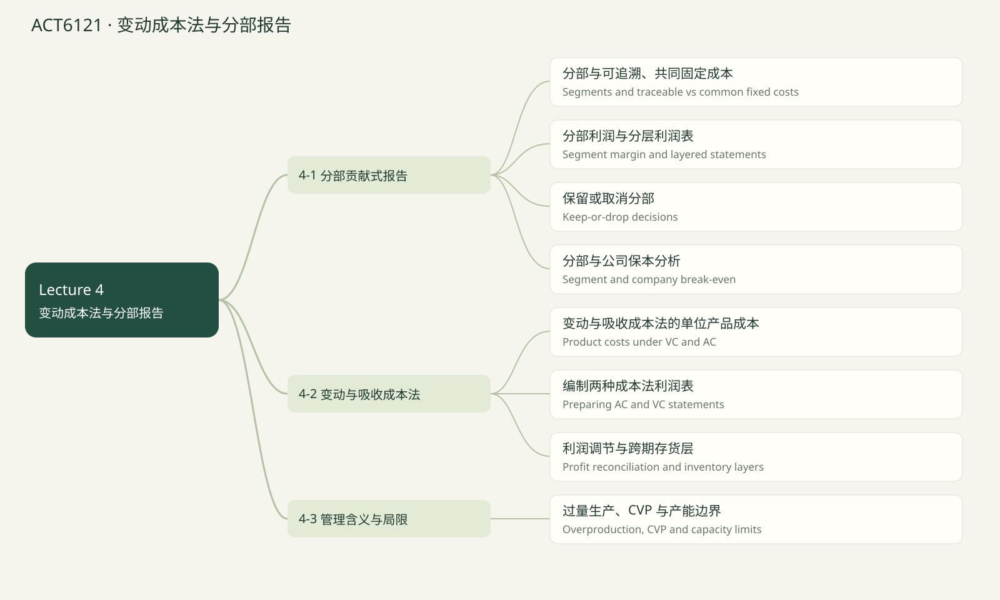

# ACT6121 · 变动成本法与分部报告 / Variable costing & segments

覆盖当前已上传 Lecture 1–5 的知识点；case study 文件夹未读取。Lecture 1课程大纲提到 life-cycle costs，但尚无该章课件，因此未假定已经讲完或排除出最终考试。后续上传后可新增章节。页码均指PDF文件页序，不是幻灯片页脚编号。

## 知识点清单

- [ ] 分部与可追溯、共同固定成本 / Segments and traceable vs common fixed costs

- [ ] 分部利润与分层利润表 / Segment margin and layered statements

- [ ] 保留或取消分部 / Keep-or-drop decisions

- [ ] 分部与公司保本分析 / Segment and company break-even

- [ ] 变动与吸收成本法的单位产品成本 / Product costs under VC and AC

- [ ] 编制两种成本法利润表 / Preparing AC and VC statements

- [ ] 利润调节与跨期存货层 / Profit reconciliation and inventory layers

- [ ] 过量生产、CVP 与产能边界 / Overproduction, CVP and capacity limits

## 分部与可追溯、共同固定成本 / Segments and traceable vs common fixed costs

来源：Lecture 4 PDF 7–12, 19–21

分部是管理者希望取得收入、成本或利润信息的任何业务部分，如店铺、地区、产品线。组织可在股权集中时仍实行经营分权。

可追溯固定成本因某分部存在而发生；共同固定成本支持多个分部，不能合理追溯给某一个。按楼面面积分摊并不会使共同成本变成可避免成本。

分类依层级而变：电视事业部经理工资对事业部可追溯，但对其电视机与机顶盒产品线是共同成本。短期退出决策还应核实可避免时点，不能一概假定可追溯等于立即节省。

Traceability depends on the segment level. Common fixed costs remain unallocated in contribution-format segment reports.

**Formula:** Company → Division → Product line

**易错点：** 同一成本在上层可追溯，在下层可共同。

### 讲解例题 / Worked example

A division manager supervises two product lines. Salary is common to those lines.

事业部经理管理两个产品线，其工资对这些产品线属于共同成本。

1. True

正确
2. False

错误

**解析 / Solution**

It is traceable to the division, not to one product line.

可追溯到事业部，不能追溯到某一产品线。

## 分部利润与分层利润表 / Segment margin and layered statements

来源：Lecture 4 PDF 13–18, 21–22

分部收入减去全部分部变动费用得到 CM；再减可追溯固定费用得到 Segment margin，用于评估长期分部盈利能力。公司 NOI = 各分部利润合计 − 公司共同固定费用。

分层报告里，上层可追溯成本在下层可能成为共同费用，应在下层利润合计之后扣除。不要为了让每个产品承担所有费用而任意分配共同费用。

CM 与 segment margin 用途不同：CM 体现覆盖固定费用的能力，segment margin 还扣除了维持分部的可追溯固定费用。

Segment margin equals contribution margin less traceable fixed costs; company common costs are deducted only at the company level.

**Formula:** Segment margin = Sales − Variable expenses − Traceable F

**易错点：** Segment margin 不是扣完任意分摊总部费用后的利润。

### 讲解例题 / Worked example

Segment sales $300,000, variable expenses $150,000, traceable F $90,000. Find segment margin.

分部收入 300,000、变动费用 150,000、可追溯 F 90,000，求分部利润。

Unit / 单位：$

**解析 / Solution**

300,000 − 150,000 − 90,000 = 60,000.

150,000 − 90,000 = 60,000。

## 保留或取消分部 / Keep-or-drop decisions

来源：Lecture 4 PDF 22–24, 32–38

判断取消业务，应比较节省的可避免成本与失去的 CM，还要计入对其他业务的影响和新费用。分摊后亏损不代表应取消。

酒吧例：CM 40,000、可避免固定成本 26,000，取消会使 NOI 降 14,000，即使被分摊共同费用 20,000 后显示亏损 6,000。

机顶盒例还改变电视销量、CMR 和广告费用，不能只看 −5,000 分部利润。若可追溯固定成本短期不能避免，则要逐项调整。

Dropping a segment is beneficial only if avoidable costs and other gains exceed lost contribution and other losses.

**Formula:** ΔNOI from dropping = Avoidable F − Lost CM + Other net effects

**易错点：** 已经分摊的共同成本不是自动可节省的成本。

### 讲解例题 / Worked example

Bar CM $40,000; avoidable F $26,000; common F stays. Find ΔNOI if dropped.

酒吧 CM 40,000，可避免 F 26,000，共同 F 不变，取消后 ΔNOI？

Unit / 单位：$

**解析 / Solution**

26,000 − 40,000 = −14,000.

26,000 − 40,000 = −14,000，应保留。

## 分部与公司保本分析 / Segment and company break-even

来源：Lecture 4 PDF 25–31, 39

分部保本 = 本分部可追溯固定费用 / 本分部 CMR，不包含公司共同固定费用。公司保本则包含所有可追溯及共同固定费用，分母使用固定组合下公司整体 CMR。

各分部恰好保本时，公司仍可能亏损共同固定费用；各分部保本额之和也不等于固定组合下公司保本额。

报告应覆盖价值链上可归属成本，避免遗漏研发、设计、营销、配送或售后。课件还介绍外部分部披露的管理层视角及内部数据公开、合并调节等权衡；此处是课程口径，不作法规更新判断。

Segment BE excludes company common fixed costs; company BE includes all fixed costs and uses the overall CM ratio.

**Formula:** Segment BE sales = Traceable F / Segment CMR

**易错点：** 不可用公司总体 CMR 替代一个分部自身 CMR。

### 讲解例题 / Worked example

Segment traceable F $90,000; CMR 50%. Find segment BE sales.

分部可追溯 F 90,000，CMR 50%，求分部保本收入。

Unit / 单位：$

**解析 / Solution**

90,000/.50 = 180,000.

90,000/.50 = 180,000。

## 变动与吸收成本法的单位产品成本 / Product costs under VC and AC

来源：Lecture 4 PDF 41–54

吸收成本法 AC 将全部制造成本计入产品成本；变动成本法 VC 只将变动制造成本计入产品成本，固定制造费用 FMOH 当期费用化。两者都将销售管理费用作为期间费用。

本课数值题把 DM、DL 视作变动；若题目另有固定直接人工等条件，需按成本行为解释，不能只背名称。

Harvey：DM+DL 8、VMOH 2、FMOH 150,000、产量 25,000，因此 VC 单位成本 10、AC 16；变动 S&A 3 不进入任一存货单价。

The key distinction is fixed manufacturing overhead: product cost under AC, period expense under VC.

**Formula:** VC unit cost = Variable manufacturing cost; AC unit cost = VC unit cost + FMOH / production

**易错点：** V S&A 是变动费用，但不是产品存货成本。

### 讲解例题 / Worked example

Variable manufacturing cost $10; FMOH $150,000; production 25,000. AC unit cost?

变动制造成本 10，FMOH 150,000，产量 25,000，AC 单位成本？

Unit / 单位：$/unit

**解析 / Solution**

10 + 150,000/25,000 = 16.

10 + 6 = 16。

## 编制两种成本法利润表 / Preparing AC and VC statements

来源：Lecture 4 PDF 55–64

VC：销售 − 变动 COGS − 变动 S&A = CM，再减全部 FMOH 和固定 S&A = NOI。COGS 使用销量，不是产量；固定制造费用使用当期总额。

AC：销售 − 吸收 COGS = 毛利，再减全部 S&A = NOI。未售产品中的 FMOH 留在存货，推迟到销售期间确认。

Harvey 第一年产 25,000、售 20,000、P30、VC单价10、AC单价16、变动 S&A3、固定 S&A100,000，VC利润90,000、AC利润120,000。

VC uses contribution format; AC uses gross margin format. Inventory defers fixed manufacturing overhead only under AC.

**Formula:** VC NOI = Qsold(P − Vmanufacturing − VS&A) − FMOH − FS&A

**易错点：** 不要在 AC 利润表既通过 COGS 扣 FMOH，又再把当期全部 FMOH 扣一次。

### 讲解例题 / Worked example

Harvey sells 20,000 at $30; variable manufacturing $10, variable S&A $3; FMOH $150,000 and FS&A $100,000. VC NOI?

Harvey 售 20,000 件，P30，变动制造10，变动 S&A3，FMOH150,000、FS&A100,000，求 VC NOI。

Unit / 单位：$

**解析 / Solution**

20,000 × (30 − 10 − 3) − 250,000 = 90,000.

340,000 − 250,000 = 90,000。

## 利润调节与跨期存货层 / Profit reconciliation and inventory layers

来源：Lecture 4 PDF 60–70; Tutorial 2 Q2

最通用的调节式：AC NOI − VC NOI = 期末存货中的 FMOH − 期初存货中的 FMOH（在本课无其他差异的设定下）。存货增加通常使 AC 利润较高，减少则相反。

仅在各存货层固定制造费用率相同时，才可简化为存货件数变化 × 单位 FMOH。年度产量变化导致率变化时，必须按 FIFO 或题目指定成本流假设跟踪历史层。

Starfax 第三年：期初 20,000 件含前期 FMOH 8/件，期末 10,000 件含当期 12/件；差额 120,000 − 160,000 = −40,000，不能只用 −10,000 × 12。

Reconcile using fixed overhead in ending inventory minus fixed overhead in beginning inventory, respecting historical layers.

**Formula:** AC NOI = VC NOI + Ending inventory FMOH − Beginning inventory FMOH

**易错点：** 率变化时，“产量减销量 × 当期率”通常会错。

### 讲解例题 / Worked example

VC NOI $90,000; beginning inventory zero; end 5,000 units carrying $6 FMOH each. AC NOI?

VC NOI90,000；期初无存货；期末5,000件、FMOH6/件，求AC NOI。

Unit / 单位：$

**解析 / Solution**

90,000 + 5,000 × 6 = 120,000.

90,000 + 30,000 = 120,000。

## 过量生产、CVP 与产能边界 / Overproduction, CVP and capacity limits

来源：Lecture 4 PDF 71–81

AC 下多生产而未售出的产品可以递延 FMOH，从而在销量不增时提高当期账面利润。这不等于现金或经济价值增加，还可能造成仓储、过时风险。

VC 将 FMOH 当期费用化，在价格、单位变动成本、总固定费用稳定时，NOI 随销量而非产量变化，适合 CVP 和短期经营分析。AC 对外报告和长期覆盖全部制造成本有价值。

两种方法的简单模型都把产能视为既定。按用量购买云服务较接近变动费用；自建基础设施有阶梯固定成本和多期需求风险，需超出单期 CVP 框架分析。

Absorption profit can rise through inventory buildup. Variable costing better isolates sales-driven performance within a fixed-capacity model.

**Formula:** More production ≠ More sales ≠ More cash

**易错点：** VC 也不能让长期产能承诺和固定费用消失。

### 讲解例题 / Worked example

Same sales; ending inventory grows by 1,000 units at a stable FMOH rate $6. Extra AC profit versus VC?

销量相同；存货增加1,000件，稳定FMOH率6，AC相对VC多多少利润？

Unit / 单位：$

**解析 / Solution**

1,000 × 6 = 6,000 deferred fixed overhead.

递延固定费用 = 6,000。

## 章节练习 / Chapter exercises

以下先列出全部题目，后附所有答案。

### 1. Starfax: three-year reconciliation

Starfax：三年利润调节

Tutorial 2 Q2，PDF p.2（重述；独立复算 / Independently derived）

Years 1/2/3: production 50,000/60,000/40,000; sales units 50,000/40,000/50,000; revenue $800,000/$640,000/$800,000. Variable manufacturing $2/unit; FMOH $480,000 annually; V S&A $1 per unit sold; fixed S&A $140,000 annually. Beginning inventory in year 1 is zero. Use FIFO and recompute FMOH rate each year using actual production.
Reported AC NOI: $30,000/$60,000/−$10,000; AC COGS $580,000/$400,000/$620,000.
1. Prepare VC statements for all years.
2. Compute AC unit costs, showing variable and fixed portions.
3. Reconcile each year and explain why year 2 income increased while sales fell.

第1/2/3年产量50,000/60,000/40,000；销量50,000/40,000/50,000；收入800,000/640,000/800,000。单位变动制造2；每年FMOH480,000；单位变动S&A1；每年固定S&A140,000。第一年期初零存货。FIFO，每年按实际产量重新算固定制造率。
已报告AC NOI30,000/60,000/−10,000；AC COGS580,000/400,000/620,000。
1. 编三年VC利润表。2. 算三年AC单价及变动/固定构成。3. 逐年调节并解释第二年销售下降但利润上升。

### 2. Vulcan: two levels of segment reporting

Vulcan：两层分部报告

Tutorial 2 Q3，PDF p.3（重述；独立复算 / Independently derived）

Company sales $750,000, variable expense $336,000, fixed expense $378,000. North sales $300,000, variable $156,000, traceable fixed $120,000. South has the remaining sales/variable costs and traceable fixed $108,000. Remaining F is company-common.
North sells Paks $50,000 and Tibs $250,000. Variable expense ratios are 22% and 58%; traceable F $30,000 and $40,000; remaining North F is common to products.
Prepare (1) company report by territory and (2) North report by product. Express each column’s costs and margins as a percentage of its own sales, rounded to one decimal.

公司收入750,000、变动费用336,000、固定费用378,000。北部收入300,000、变动156,000、可追溯固定120,000；南部承担剩余收入和变动费用，可追溯固定108,000；其余为公司共同固定。
北部Paks收入50,000、Tibs250,000；变动费用率分别22%、58%；产品可追溯F30,000、40,000；剩余北部F为产品共同费用。
编（1）按地区分部报告（2）北部按产品分部报告。各列费用、利润除以该列收入，百分比保留一位。

### 3. Segments and traceable vs common fixed costs

分部与可追溯、共同固定成本

原创基础题 / Original drill · 与模卡复测共享题目

A segment can be a sales territory rather than a legal entity.
1. True
2. False

分部可以是销售地区而非独立法人。
1. 正确
2. 错误

### 4. Segment margin and layered statements

分部利润与分层利润表

原创基础题 / Original drill · 与模卡复测共享题目

Product margins $75,000 and −$5,000; division-common F $10,000. Find division margin.

产品利润 75,000 和 −5,000，事业部共同 F 10,000，求事业部利润。

### 5. Keep-or-drop decisions

保留或取消分部

原创基础题 / Original drill · 与模卡复测共享题目

Lost CM $30,000; traceable F $40,000 but only $20,000 avoidable. Other effects zero. Find ΔNOI.

失去 CM 30,000，可追溯 F 40,000 中仅 20,000 可避免，无其他影响，求 ΔNOI。

### 6. Segment and company break-even

分部与公司保本分析

原创基础题 / Original drill · 与模卡复测共享题目

Segment sales $200,000; CM $120,000; traceable F $80,000. Find segment BE.

分部收入 200,000、CM 120,000、可追溯 F 80,000，求分部保本收入。

### 7. Product costs under VC and AC

变动与吸收成本法的单位产品成本

原创基础题 / Original drill · 与模卡复测共享题目

Variable manufacturing cost $2; FMOH $480,000; production 60,000. AC unit cost?

变动制造成本 2，FMOH 480,000，产量 60,000，求 AC 单位成本。

### 8. Preparing AC and VC statements

编制两种成本法利润表

原创基础题 / Original drill · 与模卡复测共享题目

Sales 30,000 units at $30; all variable expense $13/unit; total fixed $250,000. VC NOI?

售30,000件、P30；全部变动费用13/件；总固定250,000，求VC NOI。

### 9. Profit reconciliation and inventory layers

利润调节与跨期存货层

原创基础题 / Original drill · 与模卡复测共享题目

AC NOI $60,000; ending inventory FMOH $160,000; beginning zero. Find VC NOI.

AC NOI60,000；期末存货FMOH160,000；期初零，求VC NOI。

### 10. Overproduction, CVP and capacity limits

过量生产、CVP 与产能边界

原创基础题 / Original drill · 与模卡复测共享题目

Building a new data center with step-fixed costs is well captured by an unchanged one-period linear CVP model.
1. False
2. True

新建数据中心的阶梯固定成本可由不变的单期线性CVP模型充分描述。
1. 错误
2. 正确

---

## 全部答案与解析 / Collected solutions

### 1. Starfax: three-year reconciliation

Starfax：三年利润调节

1. Columns Y1 / Y2 / Y3:
Sales 800,000 / 640,000 / 800,000.
Variable COGS 100,000 / 80,000 / 100,000.
Variable S&A 50,000 / 40,000 / 50,000.
CM 650,000 / 520,000 / 650,000.
FMOH 480,000 each; fixed S&A 140,000 each.
VC NOI 30,000 / −100,000 / 30,000.
2. FMOH/unit 9.60 / 8.00 / 12.00; add variable $2 → AC unit costs 11.60 / 10.00 / 14.00.
3. Y1 no inventory change, difference zero. Y2 ending 20,000 units×$8 = $160,000 deferred: −100,000+160,000=60,000. Y3 beginning FMOH160,000, ending10,000×$12=120,000: 30,000+120,000−160,000=−10,000. FIFO Y3 COGS=20,000×10+30,000×14=620,000.
Y2 inventory buildup masks the sales-driven loss. Three-year VC total−40,000 versus AC80,000 differs by remaining inventory FMOH120,000.

1. 按第1/2/3年列示：收入800,000/640,000/800,000；变动COGS100,000/80,000/100,000；变动S&A50,000/40,000/50,000；CM650,000/520,000/650,000；每年FMOH480,000、固定S&A140,000；VC NOI30,000/−100,000/30,000。
2. 固定制造率9.60/8.00/12.00；加变动制造2，AC单位成本11.60/10.00/14.00。
3. 第一年存货零，差额零。第二年期末20,000件×8=160,000递延：−100,000+160,000=60,000。第三年期初FMOH160,000、期末10,000×12=120,000，AC=30,000+120,000−160,000=−10,000。FIFO第三年COGS=20,000×10+30,000×14=620,000。
第二年库存积压掩盖销售下滑带来的亏损。三年VC合计−40,000、AC80,000，相差期末仍留存的FMOH120,000。

### 2. Vulcan: two levels of segment reporting

Vulcan：两层分部报告

1. Total / North / South ($): sales750,000/300,000/450,000; variable336,000/156,000/180,000; CM414,000/144,000/270,000; traceable F228,000/120,000/108,000; territory margins186,000/24,000/162,000. Company-common F150,000; company NOI36,000.
Percent of own-column sales: variable44.8%/52.0%/40.0%; CM55.2%/48.0%/60.0%; traceable F30.4%/40.0%/24.0%; margin24.8%/8.0%/36.0%. Company-common20.0%; NOI4.8%.
2. North / Paks / Tibs: sales300,000/50,000/250,000; variable156,000/11,000/145,000; CM144,000/39,000/105,000; product-traceable F70,000/30,000/40,000; product margins74,000/9,000/65,000. North-common50,000; North margin24,000.
Percent: variable52.0%/22.0%/58.0%; CM48.0%/78.0%/42.0%; traceable F23.3%/60.0%/16.0%; product margins24.7%/18.0%/26.0%. North-common16.7%; final margin8.0%. The $50,000 is traceable at territory level but common at product level.

1. 总公司/北部/南部：收入750,000/300,000/450,000；变动336,000/156,000/180,000；CM414,000/144,000/270,000；可追溯F228,000/120,000/108,000；地区利润186,000/24,000/162,000。公司共同F150,000；NOI36,000。
各列占自身收入比：变动44.8%/52.0%/40.0%；CM55.2%/48.0%/60.0%；可追溯F30.4%/40.0%/24.0%；地区利润24.8%/8.0%/36.0%。公司共同20.0%，NOI4.8%。
2. 北部/Paks/Tibs：收入300,000/50,000/250,000；变动156,000/11,000/145,000；CM144,000/39,000/105,000；产品可追溯F70,000/30,000/40,000；产品利润74,000/9,000/65,000。北部共同50,000；北部利润24,000。
百分比：变动52.0%/22.0%/58.0%；CM48.0%/78.0%/42.0%；可追溯F23.3%/60.0%/16.0%；产品利润24.7%/18.0%/26.0%。北部共同16.7%，最终利润8.0%。50,000在地区层面可追溯，在产品层面共同。

### 3. Segments and traceable vs common fixed costs

分部与可追溯、共同固定成本

True
A segment is defined by managers’ information needs.

正确
分部由管理信息需要界定。

### 4. Segment margin and layered statements

分部利润与分层利润表

60000 $
75,000 − 5,000 − 10,000 = 60,000.

60000 $
70,000 − 10,000 = 60,000。

### 5. Keep-or-drop decisions

保留或取消分部

-10000 $
20,000 − 30,000 = −10,000.

-10000 $
仅可避免部分相关：20,000 − 30,000 = −10,000。

### 6. Segment and company break-even

分部与公司保本分析

133333.33 $
CMR = .60; 80,000/.60 = 133,333.33.

133333.33 $
CMR = .60；保本 133,333.33。

### 7. Product costs under VC and AC

变动与吸收成本法的单位产品成本

10 $/unit
2 + 480,000/60,000 = 10.

10 $/unit
2 + 8 = 10。

### 8. Preparing AC and VC statements

编制两种成本法利润表

260000 $
30,000 × 17 − 250,000 = 260,000.

260000 $
510,000 − 250,000 = 260,000。

### 9. Profit reconciliation and inventory layers

利润调节与跨期存货层

-100000 $
VC = 60,000 − 160,000 = −100,000.

-100000 $
VC = AC − 递延FMOH = −100,000。

### 10. Overproduction, CVP and capacity limits

过量生产、CVP 与产能边界

False
Capacity steps and multi-period commitments require an expanded analysis.

错误
产能台阶与多期承诺需要扩展分析。

## 课件核对说明

课件里的“单位变动制造费用”不是全部单位产品成本

PDF pp.57–59的40,000/10,000只追踪每件2元的变动制造费用，不包括每件8元DM+DL。完整VC COGS为200,000，期末存货50,000；完整AC COGS320,000，期末存货80,000。

不同年度成本率需保留存货层

Tutorial 2 Starfax的FMOH率为9.60、8、12。第三年AC−VC为120,000−160,000=−40,000，不能用净库存下降10,000×当前率12替代。

## 思维导图

