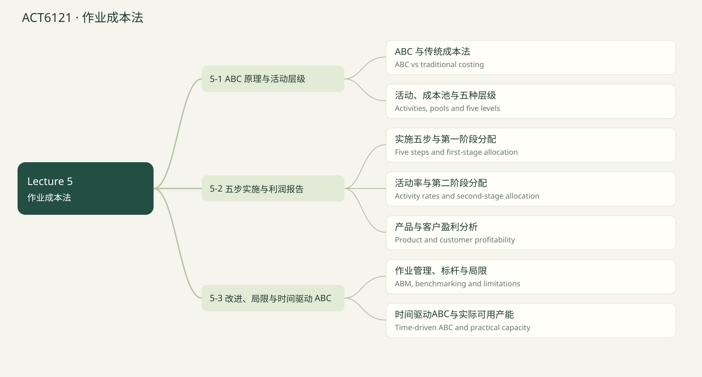

# ACT6121 · 作业成本法 / Activity-based costing

覆盖当前已上传 Lecture 1–5 的知识点；case study 文件夹未读取。Lecture 1课程大纲提到 life-cycle costs，但尚无该章课件，因此未假定已经讲完或排除出最终考试。后续上传后可新增章节。页码均指PDF文件页序，不是幻灯片页脚编号。 2024历年卷训练已融合：原卷14题及14道变式；价值指数单列补充，不冒充已上传Lecture。

## 知识点清单

- [ ] ABC 与传统成本法 / ABC vs traditional costing

- [ ] 活动、成本池与五种层级 / Activities, pools and five levels

- [ ] 实施五步与第一阶段分配 / Five steps and first-stage allocation

- [ ] 活动率与第二阶段分配 / Activity rates and second-stage allocation

- [ ] 产品与客户盈利分析 / Product and customer profitability

- [ ] 作业管理、标杆与局限 / ABM, benchmarking and limitations

- [ ] 时间驱动ABC与实际可用产能 / Time-driven ABC and practical capacity

## ABC 与传统成本法 / ABC vs traditional costing

来源：Lecture 5 PDF 3–13, 61–64

传统大平均分摊在产品同质、间接费用低时较简单；产品复杂度不同、批次和设计需求差异大时，单一产量基础可能扭曲成本，常见结果是高量简单产品被多计、低量复杂产品被少计。

本课 ABC 的三项差异：按因果关系纳入部分非制造费用；不把组织维持和闲置产能成本分到产品；使用多个活动成本池及不同驱动因素。

ABC 用于内部产品/客户盈利分析，其“产品成本”口径不等同外部存货计价。ABC 和官方吸收系统通常并存。

ABC uses causal activities, may include attributable nonmanufacturing costs, and excludes organization-sustaining and unused-capacity costs from product assignments.

**Formula:** Resources → Activities → Cost objects

**易错点：** 不是“池越多越好”，也不是把所有费用硬分给产品。

### 讲解例题 / Worked example

Shipping traceable to a product may enter its ABC product margin calculation.

可追溯到产品的运输费用可以进入ABC产品利润计算。

1. True

正确
2. False

错误

**解析 / Solution**

ABC includes attributable nonmanufacturing costs for internal analysis.

内部ABC可纳入可归属的非制造费用。

## 活动、成本池与五种层级 / Activities, pools and five levels

来源：Lecture 5 PDF 12–18, 22–23

活动是导致资源消耗的事件；成本池汇集由同一活动指标解释的成本；活动指标也称驱动因素。交易驱动因素数次数，持续时间驱动因素数小时/分钟，后者适合每次耗时差异大。

单位层级随每件发生，如机器加工；批次层级随每批发生，如设置、订单处理；产品层级维持特定产品，如设计和专利；客户层级维持客户关系；组织维持层级支持整个组织。

只有单位层级天然随产量。客户层级归客户，不应无因果依据分给产品；组织维持成本在本模型不分给产品或客户。

The five levels distinguish unit, batch, product, customer and organization-sustaining demands.

**Formula:** Transaction driver = count; Duration driver = time

**易错点：** 一个订单可能含很多件，不能把每订单成本直接当每件成本。

### 讲解例题 / Worked example

Setup once for a batch of 500 units is:

500件一批设置一次，设置属于：

1. Batch-level

批次层级
2. Unit-level

单位层级
3. Customer-level necessarily

必然客户层级

**解析 / Solution**

The setup occurs per batch, not per unit.

每批发生一次，不随批内件数逐件发生。

## 实施五步与第一阶段分配 / Five steps and first-stage allocation

来源：Lecture 5 PDF 19–32

五步：定义活动与池及指标；将间接资源成本分到池；计算活动率；按成本对象使用量二次分配；编管理报告。能直接追溯的 DM、DL、运输费先直接追溯，不能再放进池重复分配。

第一阶段把按职能归集的资源费用转成活动成本，例如间接工资6,000,000，其中30%支持订单，订单池分得1,800,000。比例可来自访谈或使用记录，每项资源分配比例应合计100%。

Baxter 的池合计22,000,000，包括客户关系3,080,000与Other6,160,000；Other不再分给产品。组合池应保持成本驱动同质性。

First-stage allocation assigns resource costs to activity pools; second-stage allocation assigns activity costs to cost objects.

**Formula:** Pool cost = Σ(Resource cost × Share used by activity)

**易错点：** 第一阶段的分配比例不是第二阶段的产品活动量。

### 讲解例题 / Worked example

Indirect wages $6,000,000; 30% used for orders. Order pool allocation?

间接工资6,000,000，订单占30%，订单池分配额？

Unit / 单位：$

**解析 / Solution**

6,000,000 × .30 = 1,800,000.

6,000,000 × .30 = 1,800,000。

## 活动率与第二阶段分配 / Activity rates and second-stage allocation

来源：Lecture 5 PDF 33–43

活动率 = 池成本 / 总活动量，单位必须写清，如每订单、每设计变更、每机器小时。第二阶段：每项活动率 × 某产品或客户活动使用量，再相加。

Baxter：订单452/单、设计760/次、机器6.50/小时、客户关系1,540/客户。产品不承担客户关系池，但客户报告可以承担。

机器时间分钟转小时：36分钟 = 0.6小时。对账时已分配给产品 + 未分给产品 = 总池成本；未分配不等于没有成本。

Apply each pool’s own rate to the object’s usage of that same activity.

**Formula:** Assigned ABC overhead = Σ(Activity rate × Object activity usage)

**易错点：** 不要用订单数量乘机器小时率，或把客户关系重复分给每个产品。

### 讲解例题 / Worked example

Order pool $4,520,000 and 10,000 orders. Cost per order?

订单池4,520,000，10,000单，求每单成本。

Unit / 单位：$/order

**解析 / Solution**

4,520,000/10,000 = 452.

4,520,000/10,000 = 452。

## 产品与客户盈利分析 / Product and customer profitability

来源：Lecture 5 PDF 44–64

ABC 产品利润 = 产品收入 − 直接成本 − 产品消耗的活动成本。客户利润还要减该客户的客户层级成本。不要将产品报告与客户报告简单相加，因为它们是同一成本的不同分析视角。

Baxter 产品利润合计7.24m，减客户关系3.08m及Other6.16m，得到总亏损2m，与传统报告勾稽。ABC改变归属与决策信息，不凭空改变总公司利润。

判断低利润客户还需考虑未来增长、忠诚度、进入壁垒与生命周期价值；分配固定费用不一定可在停止服务时立刻避免。

ABC reveals who consumes resources; reconcile object margins to total income and distinguish assigned cost from avoidable cost.

**Formula:** Customer margin = Customer revenue − Direct costs − Assigned activity costs

**易错点：** ABC分配成本不自动等于短期可避免成本。

### 讲解例题 / Worked example

Customer sales $29,200; direct costs $15,900; assigned ABC $12,916. Customer margin?

客户收入29,200，直接成本15,900，ABC分配12,916，求客户利润。

Unit / 单位：$

**解析 / Solution**

29,200 − 15,900 − 12,916 = 384.

29,200 − 28,816 = 384。

## 作业管理、标杆与局限 / ABM, benchmarking and limitations

来源：Lecture 5 PDF 65–72, 79–80

ABM 用活动信息识别浪费、减少加工时间和缺陷；benchmarking 对比活动成本和流程，寻找改善机会。但高活动率也可能反映复杂度、服务质量或低容量利用，不能仅看一个数字就认定低效。

ABC 局限：实施维护消耗资源；员工抵触陌生报告；想把一切分给产品的压力；把分配成本误作可避免成本；口径与对外报表不一致，需要两个系统和调节。

AI 过程挖掘可帮助发现活动和时间，自动归类及更新成本率；人仍需选择活动颗粒度、验证因果关系、解释闲置产能并做经营决策。

ABM uses activity data to improve processes; benchmark comparable activities and avoid equating allocated costs with immediate savings.

**Formula:** Reduce activity demand → Free resources → Redeploy or remove capacity → Realized savings

**易错点：** 活动次数下降，不保证固定资源支出立即下降。

### 讲解例题 / Worked example

Reducing orders by 10% automatically cuts salaried order-processing cost by 10%.

订单减少10%会自动让固定薪酬订单处理成本下降10%。

1. False

错误
2. True

正确

**解析 / Solution**

Capacity must be removed or redeployed for financial benefit.

需要释放、取消或重新利用资源，才形成财务收益。

## 时间驱动ABC与实际可用产能 / Time-driven ABC and practical capacity

来源：Lecture 5 PDF 73–78

TDABC 以资源每单位时间成本和活动所需时间估计成本，减少大规模员工访谈及自报闲置比例的依赖。容量成本率 = 供给资源成本 / practical capacity。

Practical capacity 是扣除休息、培训等后的可用时间，不能把实际使用时间当分母，否则闲置成本被塞进产品。课件常用理论产能75%–85%作为估计，实际应用需按情境测量。

活动成本 = 时间率 × 所需分钟；已用资源成本 = 使用分钟 × 时间率；闲置成本 = 未用可用分钟 × 时间率。Baxter 的精确率634,500/1,404,000 ≈ 0.451923，显示0.45不等于中间计算应只用0.45。

TDABC applies a practical-capacity cost rate to required activity time and reports unused capacity separately.

**Formula:** Capacity cost rate = Resource cost / Practical minutes; Cost = Rate × Minutes required

**易错点：** 先保留精确率，最后舍入；分母不是实际使用分钟。

### 讲解例题 / Worked example

Resource cost $60,000; practical capacity 120,000 minutes. Cost per minute?

资源成本60,000，实际可用产能120,000分钟，求每分钟率。

Unit / 单位：$/min

**解析 / Solution**

60,000/120,000 = .50.

60,000/120,000 = .50。

## 章节练习 / Chapter exercises

以下先列出全部题目，后附所有答案。

### 1. 2024 A3 · ABC boundaries

2024 A3 · ABC boundaries

2024 原题 · 2分 · 用户提供的期中答案卷；英文题面保留实质内容，表格转写 / Past-paper question

Which statement about ABC is correct?
A) In some special cases an activity could be both batch level and product level.
B) A change to ABC is beneficial when firms significantly increase production scale.
C) Under ABC, idle-capacity costs will be included in financial statements.
D) In first-stage allocation, all overhead costs go to activity pools which are subsequently allocated to specific cost objects.

哪项ABC表述正确？A 特殊情况某活动可同时为批次与产品层级；B 扩大生产规模就有利于改用ABC；C 闲置产能成本会列入财务报表；D 第一阶段所有间接成本池随后都分给具体成本对象。

### 2. Variation · A3

变式训练 · A3

2024 A3 原创变式 · 训练参考分值2分 / Original variation

A pool contains$50,000 unused-capacity cost and$150,000 consumed product resources. Should all$200,000 be assigned to products under the lecture’s ABC model? Explain reconciliation.

成本池含闲置50,000与产品耗用150,000。按本课ABC是否全部200,000分给产品？说明勾稽。

### 3. 2024 C5 · Javier · ABC and cost-plus pricing

2024 C5 · Javier · ABC and cost-plus pricing

2024 原题 · 12分 · 用户提供的期中答案卷；英文题面保留实质内容，表格转写 / Past-paper question

A/B volume2,500/5,000; DM40/60; DL2/3hours at$12; traditional overhead2/3hours at$93. TotalMOH1,860,000 over20,000DLH. ABC pools: setups240,000,countsA100/B20; general factory1,500,000,DLHA5,000/B15,000; machine processing120,000,MHA2,200/B800. Price=total unit cost plus40%.
1 Traditional B unit cost/price(3points).2 ABC B unit cost/price(7).3 Does ABC support greater B price competitiveness?(2).

A/B产量2,500/5,000；DM40/60；DL2/3小时、时薪12；传统MOH率93/DLH，总MOH1,860,000、20,000DLH。ABC：设置240,000，A100次/B20次；工厂1,500,000，A5,000DLH/B15,000DLH；机器120,000，A2,200MH/B800MH。价格=单位成本加成40%。求B传统成本售价（3分）、ABC成本售价（7）、价格竞争力解释（2）。

### 4. Variation · C5

变式训练 · C5

2024 C5 原创变式 · 训练参考分值12分 / Original variation

Keep original pools and A/B volumes,but B setups rise to40,A setups fall to80 (total120); machine usage unchanged. Find B ABC overhead/unit,cost and price at40% markup. Explain effect of complexity and distinguish markup from margin.

成本池及产量不变，B设置升至40次、A降至80次，总120，机器用量不变。求B ABC单位MOH、成本及40%加成售价，解释复杂度和加成率/利润率区别。

### 5. Baxter: from pools to profitability

Baxter：从成本池到产品及客户利润

Lecture 5 pp.20–64（课件整合题 / Lecture-based synthesis）

Pools: orders $4.52m / 10,000 orders; designs $3.04m / 4,000 designs; machine activity $5.2m / 800,000 MH; customer relations $3.08m / 2,000 customers; Other $6.16m.
SureStart: sales31.3m, DM9m, DL7m, shipping2m; 4,000 orders, zero designs,480,000MH.
LongLife: sales18.7m, DM6m, DL5m, shipping1m;6,000 orders,4,000 designs,320,000MH.
Customer PE: sales29,200, DM7,500, DL6,700, shipping1,700;12 orders,4 designs,448MH,one customer.
Find activity rates, each product’s overhead and margin, company income and PE’s margin. Compare with a traditional $14m MOH allocation based on total MH (exclude S&A from traditional product margins). Explain why the margins differ.

成本池：订单4.52百万/10,000单；设计3.04百万/4,000次；机器5.2百万/800,000MH；客户关系3.08百万/2,000客户；Other6.16百万。
SureStart收入31.3百万，DM9百万、DL7百万、运输2百万；4,000订单、0设计、480,000MH。
LongLife收入18.7百万，DM6百万、DL5百万、运输1百万；6,000订单、4,000设计、320,000MH。
客户PE收入29,200、DM7,500、DL6,700、运输1,700；12订单、4设计、448MH、1客户。
求活动率、各产品分配额与利润、公司利润及PE利润。与按MH分配14百万MOH的传统产品利润比较（传统产品利润不扣S&A），解释差异。

### 6. TDABC: used and unused capacity

TDABC：已用与闲置产能

Lecture 5 pp.76–78（课件数据复算及补充 / Recomputed and extended）

15 employees earn $42,300 each annually. Each has 2,400 minutes per week,52 weeks,75% practical capacity. Activity time: order30min, design90min, assistance80min. All customers require10,000 orders,4,000 designs,2,000 assistance events.
Compute practical capacity, exact cost rate, activity rates, utilized minutes, unused minutes and unused-capacity cost. Then compute Auto Services cost for59 orders,15 designs,15 assistance events. Do not round intermediate calculations.

15名员工年薪各42,300；每人每周2,400分钟、52周、实际可用比例75%。活动耗时：订单30分钟、设计90分钟、协助80分钟。所有客户合计10,000订单、4,000设计、2,000协助。
求实际可用产能、精确时间率、活动率、已用/闲置分钟及闲置成本。再算Auto Services的59订单、15设计、15协助成本。中间不舍入。

### 7. ABC vs traditional costing

ABC 与传统成本法

原创基础题 / Original drill · 与模卡复测共享题目

ABC product cost automatically equals external inventory cost.
1. False
2. True

ABC产品成本自动等于外部存货成本。
1. 错误
2. 正确

### 8. Activities, pools and five levels

活动、成本池与五种层级

原创基础题 / Original drill · 与模卡复测共享题目

Maintaining a patent for one product is:
1. Product-level
2. Batch-level
3. Unit-level

维持某产品专利属于：
1. 产品层级
2. 批次层级
3. 单位层级

### 9. Five steps and first-stage allocation

实施五步与第一阶段分配

原创基础题 / Original drill · 与模卡复测共享题目

Total indirect resources $22m; product pools $12.76m; customer pool $3.08m. Other pool in dollars?

间接资源22百万，产品池12.76百万、客户池3.08百万，Other池多少美元？

### 10. Activity rates and second-stage allocation

活动率与第二阶段分配

原创基础题 / Original drill · 与模卡复测共享题目

Customer: 12 orders at $452, 4 designs at $760, 448 MH at $6.50, customer cost $1,540. Assigned overhead?

客户12单×452、4设计×760、448MH×6.50、客户成本1,540，求分配额。

### 11. Product and customer profitability

产品与客户盈利分析

原创基础题 / Original drill · 与模卡复测共享题目

LongLife revenue $18.7m, DM $6m, DL $5m, shipping $1m, ABC overhead $7.832m. Product margin in dollars?

LongLife收入18.7百万，DM6百万、DL5百万、运输1百万、ABC7.832百万，求产品利润美元。

### 12. ABM, benchmarking and limitations

作业管理、标杆与局限

原创基础题 / Original drill · 与模卡复测共享题目

Maintaining a very large ABC model can be costly.
1. True
2. False

维护很大的ABC模型可能成本很高。
1. 正确
2. 错误

### 13. Time-driven ABC and practical capacity

时间驱动ABC与实际可用产能

原创基础题 / Original drill · 与模卡复测共享题目

Resource cost $634,500, capacity 1,404,000 minutes. Customer requires 59×30 + 15×90 + 15×80 minutes. Assigned cost, 2 decimals?

成本634,500、产能1,404,000分钟；客户需59×30 + 15×90 + 15×80分钟，分配多少？

---

## 全部答案与解析 / Collected solutions

### 1. 2024 A3 · ABC boundaries

2024 A3 · ABC boundaries

C (marked in the provided key). Exclusion from product/customer assignment does not erase idle-capacity cost from company financial statements. Scale alone does not establish ABC usefulness; heterogeneity matters. Other/organization-sustaining pools need not be assigned to specific products/customers. For the exam, classify an activity by the stated cost driver and level.

C（原卷标注）。闲置成本不分入产品，不代表不进入公司财务报表。ABC价值取决于资源消耗差异而非仅规模；Other等池不再强行分给产品或客户。层级按题面活动与驱动因素判断。

### 2. Variation · A3

变式训练 · A3

No. Assign150,000; show50,000 separately. Both remain within company total costs200,000.

分给产品150,000；闲置50,000单列，公司总成本仍200,000。

### 3. 2024 C5 · Javier · ABC and cost-plus pricing

2024 C5 · Javier · ABC and cost-plus pricing

Traditional B cost60+36+279=375;price525. ABC rates2,000/setup,75/DLH,40/MH. B overhead40,000+1,125,000+32,000=1,197,000; /5,000=239.40/unit. Cost335.40;price469.56. Lower assigned B cost permits a lower cost-plus quote. This changes attribution, not automatically real resource spending. General factory pool has an explicitly supplied DLH driver; use it here instead of removing it merely because of its name.

传统B单位成本375、售价525。ABC率2,000/设置、75/DLH、40/MH；B分配1,197,000，单位239.40，加DM60、DL36=335.40；售价469.56。归属成本降低允许降低加成报价，不代表资源支出自动减少。general factory池题目明确用DLH驱动，按给定模型使用，不能因名称就全部剔除。

### 4. Variation · C5

变式训练 · C5

BMOH80,000+1,125,000+32,000=1,237,000;unit247.40;cost343.40;price480.76. 40% cost markup means gross margin40/140=28.5714%,not40% of revenue.

B MOH1,237,000、单位247.40；成本343.40；售价480.76。40%成本加成对应收入利润率28.5714%，不是40%。

### 5. Baxter: from pools to profitability

Baxter：从成本池到产品及客户利润

Rates: $452/order, $760/design, $6.50/MH, $1,540/customer.
SureStart overhead=1.808m+3.12m=4.928m; margin=31.3−9−7−2−4.928=8.372m.
LongLife overhead=2.712+3.04+2.08=7.832m; margin=18.7−6−5−1−7.832=−1.132m.
Company=8.372−1.132−3.08−6.16=−2m.
PE overhead=5,424+3,040+2,912+1,540=12,916; margin=29,200−7,500−6,700−1,700−12,916=384.
Traditional rate14m/800,000=$17.50/MH; overhead8.4m/5.6m; product margins6.9m/2.1m. Subtract all S&A11m from total9m → company−2m.
The traditional method ignores non-volume activity consumption, allocates all manufacturing overhead and excludes S&A from product margins. ABC changes the cost scope and attribution, revealing LongLife’s design and order intensity.

率：订单452、设计760、机器6.50、客户1,540。
SureStart分配1.808+3.12=4.928百万；利润31.3−9−7−2−4.928=8.372百万。
LongLife分配2.712+3.04+2.08=7.832百万；利润18.7−6−5−1−7.832=−1.132百万。
公司8.372−1.132−3.08−6.16=−2百万。
PE分配5,424+3,040+2,912+1,540=12,916；利润384。
传统率14百万/800,000=17.50/MH；分配8.4/5.6百万；产品利润6.9/2.1百万，合计9百万减全部S&A11百万=−2百万。
传统方法忽略非产量活动差异、将全部制造费用分给产品，并在产品利润中排除S&A。ABC调整范围和归属，显示LongLife设计与订单资源需求高。

### 6. TDABC: used and unused capacity

TDABC：已用与闲置产能

Resource cost634,500; practical minutes15×2,400×52×.75=1,404,000. Rate=634,500/1,404,000=.4519230769 per minute.
Activity rates13.5576923 /40.6730769 /36.1538462 dollars (display13.56/40.67/36.15).
Used minutes300,000+360,000+160,000=820,000. Unused584,000; used cost370,576.92; unused cost263,923.08; sum634,500.
Auto Services minutes1,770+1,350+1,200=4,320; costs799.90+610.10+542.31=1,952.31 using unrounded values. The lecture’s order row $36.15 and total $1,188.56 do not follow from the stated activity counts.

资源成本634,500；实际可用分钟15×2,400×52×.75=1,404,000；精确率.4519230769。
活动率13.5576923/40.6730769/36.1538462，显示为13.56/40.67/36.15。
已用分钟300,000+360,000+160,000=820,000；闲置584,000。已用成本370,576.92，闲置263,923.08，合计634,500。
Auto Services耗时1,770+1,350+1,200=4,320；按精确率成本799.90+610.10+542.31=1,952.31。课件订单行36.15及总额1,188.56与所列活动数量不一致。

### 7. ABC vs traditional costing

ABC 与传统成本法

False
The cost scope and exclusions can differ.

错误
成本范围和排除项目可能不同。

### 8. Activities, pools and five levels

活动、成本池与五种层级

Product-level
The activity supports the product irrespective of units or batches.

产品层级
支持产品存在，不取决于件数或批数。

### 9. Five steps and first-stage allocation

实施五步与第一阶段分配

6160000 $
22,000,000 − 12,760,000 − 3,080,000 = 6,160,000.

6160000 $
22,000,000 − 12,760,000 − 3,080,000 = 6,160,000。

### 10. Activity rates and second-stage allocation

活动率与第二阶段分配

12916 $
5,424 + 3,040 + 2,912 + 1,540 = 12,916.

12916 $
5,424 + 3,040 + 2,912 + 1,540 = 12,916。

### 11. Product and customer profitability

产品与客户盈利分析

-1132000 $
18,700,000 − 6,000,000 − 5,000,000 − 1,000,000 − 7,832,000 = −1,132,000.

-1132000 $
18,700,000 − 19,832,000 = −1,132,000。

### 12. ABM, benchmarking and limitations

作业管理、标杆与局限

True
Data collection and maintenance are key implementation costs.

正确
数据采集维护是关键实施成本。

### 13. Time-driven ABC and practical capacity

时间驱动ABC与实际可用产能

1952.31 $
Time = 4,320; rate = 634,500/1,404,000; cost = 1,952.3077 → 1,952.31.

1952.31 $
耗时4,320；乘精确率得到1,952.31。

## 课件核对说明

TDABC Auto Services 行的数字不一致

PDF p.78：59订单×30分钟×(634,500/1,404,000)=799.90，而不是表中36.15；加15设计与15协助后合计1,952.31，而非1,188.56。计算使用精确时间率，显示金额最后保留两位。

2024历年卷训练

章节练习顶部优先排列2024原题与对应变式。题目与答案均可切换中英。综合题由你依据步骤自评；不会时可把关联知识点加入回炉。原题保留年份与分值；变式明确为原创。

## 思维导图

